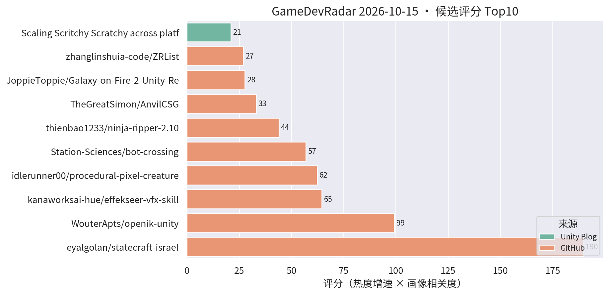
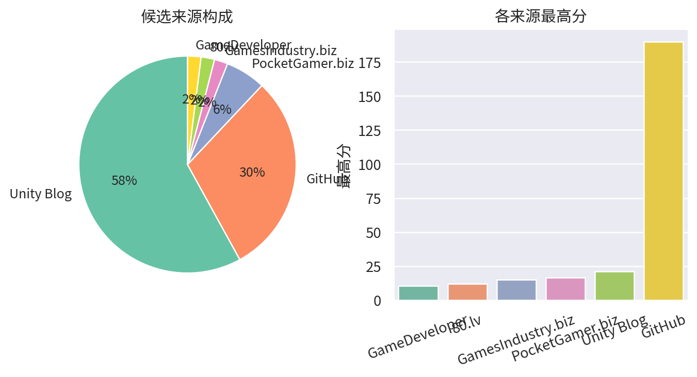

# 游戏开发技术雷达 · 2026-10-15（LLM 点评版）

**今日看点**
1. 行业新信号：Playgama 发布"让 AI agent 发布和改进游戏"的工具套件——AI agent 从做游戏扩展到发行/运营环节，做商业化或 AI 工作流的值得读。
2. openik-unity 六日稳涨至 85★、bot-crossing 达 816★——动画工具与"AI 玩游戏"两个常驻方向热度不减。
3. statecraft-israel 五连冠（253★）但评分开始衰减（236→189.75）——政治题材纯游戏作品，维持剔除。

| # | 评分 | 项目 / 话题 | 来源 | 信号 | 简介 | 点评 |
|---|---|---|---|---|---|---|
| 1 | 99.19 | [WouterApts/openik-unity](https://github.com/WouterApts/openik-unity) | github | 85★ / 6天 | Inverse Kinematics package for Unity, featuring multiple solvers, joint limits and procedural animation samples. | Unity IK 包：CCD/FABRIK 多求解器 + 关节限制 + 程序化动画示例，六日稳涨；做动画/TA/程序化动作的值得立刻试，真工具无水分。 |
| 2 | 64.62 | [kanaworksai-hue/effekseer-vfx-skill](https://github.com/kanaworksai-hue/effekseer-vfx-skill) | github | 47★ / 4天 | Agent skills that make real-time game VFX as code for Effekseer and verify them in real Godot renders (Claude Code, Codex and other Agent Skills hosts). | 让 AI agent 用代码编写 Effekseer 实时特效并在引擎内渲染验证的 agent skill；验证基于 Godot，但 Effekseer 可接 Unity，做 VFX/TA + AI 工作流的值得试。 |
| 3 | 56.94 | [Station-Sciences/bot-crossing](https://github.com/Station-Sciences/bot-crossing) | github | 816★ / 43天 | A video game for AI agents. Created by Jarren Rocks | "AI agent 玩的游戏"品类样本，816★ 热度稳定；做 AI 玩法/AI 游戏的值得看它怎么把 agent 当玩家设计。 |
| 4 | 33.18 | [TheGreatSimon/AnvilCSG](https://github.com/TheGreatSimon/AnvilCSG) | github | 166★ / 30天 | Anvil CSG Beta 2: a free legacy preview of brush-based level design inside Unity. Hammer-inspired workflow, Built-in and URP. | Hammer 式笔刷关卡设计工具，满月仍稳；Unity 关卡白盒刚需，做关卡/TA 的强烈建议试。 |
| 5 | 27.0 | [zhanglinshuia-code/ZRList](https://github.com/zhanglinshuia-code/ZRList) | github | 63★ / 7天 | Unity uGUI virtualized list and grid components with dynamic sizing, multiple item prefabs, collapsible trees, nested scrolling, and animated navigation. | uGUI 虚拟化列表/网格组件：动态尺寸、多 prefab、折叠树、嵌套滚动一次配齐；做卡牌/背包/列表 UI 的性能刚需，直接对口，建议试。 |
| 6 | 21.0 | [Scaling Scritchy Scratchy across platforms](https://unity.com/blog/scaling-scritchy-scratchy-across-platforms) | Unity Blog | 官方发布 | Learn how Scritchy Scratchy used Unity to port the game across platforms. | 官方跨平台移植案例，多平台适配的实战参考。 |
| 7 | 16.5 | [Echo Weaver：Unity 6 时间循环 metroidbrainia](https://unity.com/blog/echo-weaver-time-loop-unity) | Unity Blog | 官方发布 | Moonlight Kids 讲解如何用 Unity 6 构建时间循环玩法。 | 官方案例：时间循环 + 银河城式地图状态管理，做关卡/系统设计的值得看拆解。 |
| 8 | 16.5 | [Backyard Baseball 3D 关卡与 VFX 复盘](https://unity.com/blog/reimagining-backyard-baseball-3d-level-design-and-environment-art) | Unity Blog | 官方发布 | Mega Cat Studios 用可读性关卡设计、decal、灯光和 VFX 把 Backyard Baseball 2026 做成 3D。 | 官方案例：decal + 灯光的可读性关卡设计，对移动端场景表现力有参考价值。 |
| 9 | 16.5 | [Playgama 发布 AI agent 游戏发行/改进工具](https://www.pocketgamer.biz/playgama-launches-tools-for-ai-agents-to-publish-and-improve-games/) | PocketGamer.biz | 官方发布 | Playgama 推出让 AI agent 发布和改进游戏的工具套件。 | 行业新信号：AI agent 从开发环节扩展到发行/运营环节；做商业化或 AI 工作流的值得读，关注其分发渠道玩法。 |
| 10 | 15.64 | [UpstandPlatform/OpenRive](https://github.com/UpstandPlatform/OpenRive) | github | 30★ / 22天 | Build interactive UIs, motion, and game experiences in the OpenRive Editor, or let an AI agent generate them through the CLI. | 开源 Rive 替代品，亮点是 AI agent 可用 CLI 直接生成动画 UI；游戏 UI 动效管线 + AI 工作流方向值得跟踪。 |
| 11 | 15.45 | [frrazer/roblox-game-boilerplate](https://github.com/frrazer/roblox-game-boilerplate) | github | 103★ / 20天 | Roblox game boilerplate for AI agents: Rojo, Wally, typed Packet networking, ProfileStore data, strict Luau and an AGENTS.md | 专为 AI agent 协作设计的 Roblox 工程模板（自带 AGENTS.md）；"AI 友好型工程结构"参考样本，对 Unity 项目的 AI 协作改造有借鉴意义。 |
| 12 | 15.0 | [Content directories：超越 AssetBundle](https://unity.com/blog/content-directories-beyond-the-assetbundle) | Unity Blog | 官方发布 | Unity 6.6 引入 content directories，更快更细粒度的 AssetBundle 替代方案，支持远程分发。 | 资源系统换代 + 远程分发内置，做热更/资源管理的一线开发者必看。 |
| 13 | 15.0 | [Deep Rock Galactic: Survivor 手游优化复盘](https://unity.com/blog/optimizing-deep-rock-galactic-survivor-for-mobile) | Unity Blog | 官方发布 | Piktiv 如何把 Deep Rock Galactic: Survivor 移植到移动端。 | 幸存者 like 爆款的手游移植优化复盘，海量同屏单位的性能处理对商业手游直接对口。 |
| 14 | 15.0 | [Unity 官方 Codex 插件](https://unity.com/blog/unity-plugin-codex) | Unity Blog | 官方发布 | Unity's official plugin for Codex. | 官方 Codex 插件官宣，Unity 官方 AI 编码助手成型；做 AI 工作流的必看。 |
| 15 | 15.0 | [Sente 六人策略的数据驱动棋盘](https://unity.com/blog/data-driven-board-six-player-strategy-sente) | Unity Blog | 官方发布 | Oxobox 用 Timeline + 数据驱动棋盘做六人同时回合制策略游戏。 | 数据驱动棋盘 + Timeline 表现层，做战棋/卡牌的架构可参考。 |

---
*由 GameDevRadar 生成 · 点评由 LLM 按 profile.json 画像撰写 · 原始榜单见 daily.md*
