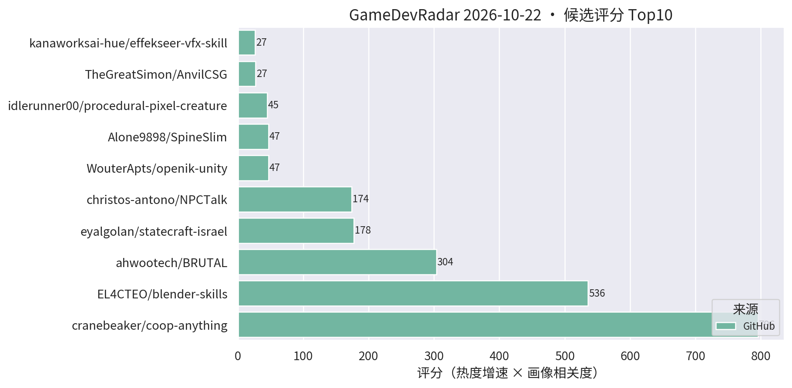
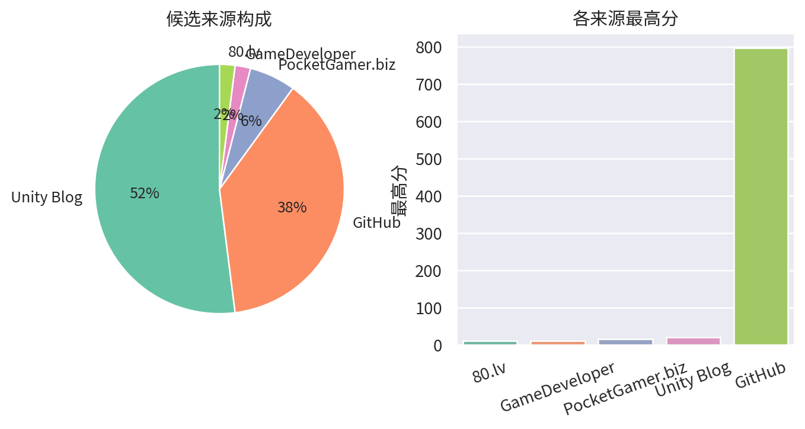

# 游戏开发技术雷达 · 2026-10-22（LLM 点评版）

**今日看点**
1. 双对口新面孔：SpineSlim（Spine 资源版本转换/纹理压缩/批量整理的桌面工具，31★/6天）与 VFX-Essential-Shader（URP 全家桶 VFX shader + 自定义材质面板，32★/15天）——一个管 2D 资源管线、一个管 URP 特效，都是手游一线刚需。
2. coop-anything 五日 796★ 逼近 800——"AI 逆向单机加联机"继续领跑 agent skill 板块。
3. BRUTAL 2125★/7天、blender-skills 341★/7天——C# 底座框架与 Blender 技能包高位稳增，本周两大主线未变。

| # | 评分 | 项目 / 话题 | 来源 | 信号 | 简介 | 点评 |
|---|---|---|---|---|---|---|
| 1 | 796.0 | [cranebeaker/coop-anything](https://github.com/cranebeaker/coop-anything) | github | 796★ / 5天 | Co-op Anything: point your AI agent at any single-player game and play it with friends (online and/or splitscreen!). MCP server and playbook to reverse engineer, fix, test, ship and share. | "让 AI agent 把任意单机游戏逆向改造成联机"的 MCP 服务器 + 方法论，五日近 800★；代表 agent 逆向工作流方向，注意版权边界，看技术思路即可。 |
| 2 | 535.81 | [EL4CTEO/blender-skills](https://github.com/EL4CTEO/blender-skills) | github | 341★ / 7天 | Professional Blender 5.2 workflows as Agent Skills for Claude Code, Codex, Gemini CLI, Copilot and Cursor: modeling, UVs, PBR, baking, rigging, animation, export and QA. | Blender 5.2 专业工作流整体 skill 化（建模/UV/PBR/烘焙/绑定/导出/QA），七日 341★；做 TA/资产管线的强烈建议立刻试，AI 工作流直接对口。 |
| 3 | 303.57 | [ahwootech/BRUTAL](https://github.com/ahwootech/BRUTAL) | github | 2125★ / 7天 | A free, open source C# framework for making games, or your own game engine. Direct access to native APIs and Vulkan, with the low-level libraries around them. The foundation under Kitten Space Agency and RimWorld's Waylith engine. | 开源 C# 底层游戏框架：原生 API + Vulkan 直访，RimWorld 新作引擎底座，七日 2125★；虽非 Unity 插件，但 .NET 游戏开发底座级事件，做引擎/底层的必看。 |
| 4 | 174.19 | [christos-antono/NPCTalk](https://github.com/christos-antono/NPCTalk) | github | 190★ / 6天 | Make any NPC in any game talk back with Fish Audio: skills, a self-hosted voice server and tools for AI coding agents, with a full GTA V example. | 让任意游戏 NPC 开口说话的 agent skill 套件：Fish Audio TTS + 自托管语音服务 + GTA V 完整示例，六日 190★；做 AI NPC/语音交互的值得看，mod 向而非 Unity 工程向。 |
| 5 | 46.83 | [WouterApts/openik-unity](https://github.com/WouterApts/openik-unity) | github | 87★ / 13天 | Inverse Kinematics package for Unity, featuring multiple solvers, joint limits and procedural animation samples. | Unity IK 包：CCD/FABRIK 多求解器 + 关节限制 + 程序化动画示例；做动画/TA/程序化动作的值得立刻试，真工具无水分。 |
| 6 | 46.53 | [Alone9898/SpineSlim](https://github.com/Alone9898/SpineSlim) | github | 31★ / 6天 | Spine 资源优化与批量处理工具，支持版本转换、纹理压缩和 PC / 移动端资源整理。 | Spine 资源优化桌面工具：版本转换 + 纹理压缩 + PC/移动端资源整理一站搞定；做 2D/卡牌手游资源管线的直接对口，建议试。 |
| 7 | 26.94 | [TheGreatSimon/AnvilCSG](https://github.com/TheGreatSimon/AnvilCSG) | github | 166★ / 37天 | Anvil CSG Beta 2: a free legacy preview of brush-based level design inside Unity. Hammer-inspired workflow, Built-in and URP. | Hammer 式笔刷关卡设计工具，Built-in/URP 双支持；Unity 关卡白盒刚需，做关卡/TA 的强烈建议试。 |
| 8 | 26.51 | [kanaworksai-hue/effekseer-vfx-skill](https://github.com/kanaworksai-hue/effekseer-vfx-skill) | github | 53★ / 11天 | Agent skills that make real-time game VFX as code for Effekseer and verify them in real Godot renders (Claude Code, Codex and other Agent Skills hosts). | 让 AI agent 用代码编写 Effekseer 实时特效并在引擎内渲染验证的 agent skill；验证基于 Godot，但 Effekseer 可接 Unity，做 VFX/TA + AI 工作流的值得试。 |
| 9 | 21.0 | [Scaling Scritchy Scratchy across platforms](https://unity.com/blog/scaling-scritchy-scratchy-across-platforms) | Unity Blog | 官方发布 | Learn how Scritchy Scratchy used Unity to port the game across platforms. | 官方跨平台移植案例，多平台适配的实战参考。 |
| 10 | 19.17 | [excifroge/VFX-Essential-Shader](https://github.com/excifroge/VFX-Essential-Shader) | github | 32★ / 15天 | VFX Essential Shader: an all-in-one VFX shader for Unity URP with a custom material inspector. | URP 全家桶 VFX shader + 自定义材质面板，一个材质应付多种特效需求；做手游特效的值得试，小体量项目尤其省事。 |
| 11 | 17.48 | [UpstandPlatform/OpenRive](https://github.com/UpstandPlatform/OpenRive) | github | 44★ / 29天 | Build interactive UIs, motion, and game experiences in the OpenRive Editor, or let an AI agent generate them through the CLI. | 开源 Rive 替代品，亮点是 AI agent 可用 CLI 直接生成动画 UI；游戏 UI 动效管线 + AI 工作流方向值得跟踪。 |
| 12 | 16.5 | [Echo Weaver：Unity 6 时间循环 metroidbrainia](https://unity.com/blog/echo-weaver-time-loop-unity) | Unity Blog | 官方发布 | Moonlight Kids 讲解如何用 Unity 6 构建时间循环玩法。 | 官方案例：时间循环 + 银河城式地图状态管理，做关卡/系统设计的值得看拆解。 |
| 13 | 16.5 | [Backyard Baseball 3D 关卡与 VFX 复盘](https://unity.com/blog/reimagining-backyard-baseball-3d-level-design-and-environment-art) | Unity Blog | 官方发布 | Mega Cat Studios 用可读性关卡设计、decal、灯光和 VFX 把 Backyard Baseball 2026 做成 3D。 | 官方案例：decal + 灯光的可读性关卡设计，对移动端场景表现力有参考价值。 |
| 14 | 15.63 | [zhanglinshuia-code/ZRList](https://github.com/zhanglinshuia-code/ZRList) | github | 73★ / 14天 | Unity uGUI virtualized list and grid components with dynamic sizing, multiple item prefabs, collapsible trees, nested scrolling, and animated navigation. | uGUI 虚拟化列表/网格组件：动态尺寸、多 prefab、折叠树、嵌套滚动一次配齐；做卡牌/背包/列表 UI 的性能刚需，直接对口，建议试。 |
| 15 | 15.0 | [Foxy Dumplings 跨平台开发复盘](https://unity.com/blog/foxy-dumplings-cross-platform-development) | Unity Blog | 官方发布 | Soft Crunch Games 用一个 Unity 工程做全平台的方法。 | 官方案例：单工程多平台的工程组织方式，做跨平台项目结构的可参考。 |
| 16 | 15.0 | [Content directories：超越 AssetBundle](https://unity.com/blog/content-directories-beyond-the-assetbundle) | Unity Blog | 官方发布 | Unity 6.6 引入 content directories，更快更细粒度的 AssetBundle 替代方案，支持远程分发。 | 资源系统换代 + 远程分发内置，做热更/资源管理的一线开发者必看。 |

---
*由 GameDevRadar 生成 · 点评由 LLM 按 profile.json 画像撰写 · 原始榜单见 daily.md*
