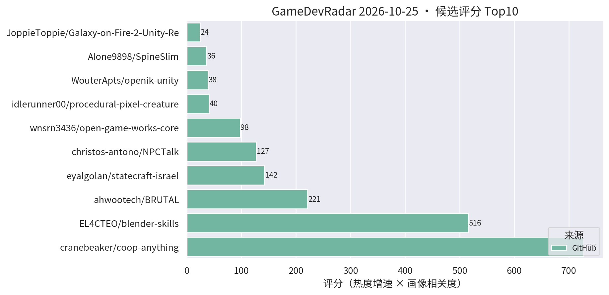
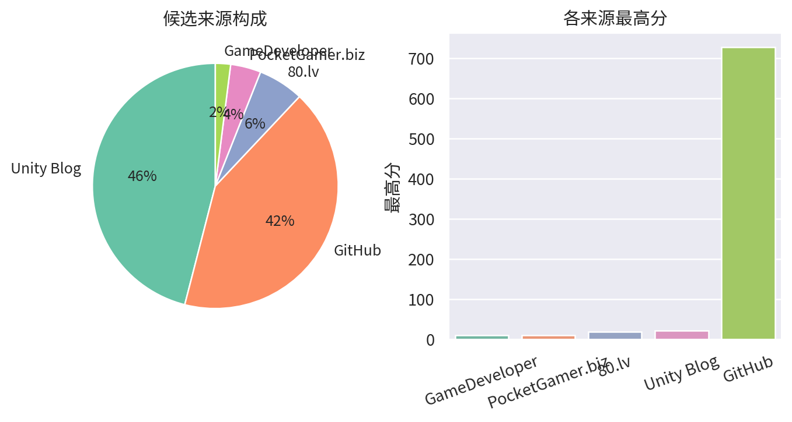

# 游戏开发技术雷达 · 2026-10-25（LLM 点评版）

**今日看点**
1. coop-anything 1163★/8天 继续领跑；open-game-works-core 次日评分近翻倍（52.5→97.5，13★）——"AI 全流程做游戏"harness 开始起量，保持观望。
2. 灰色仓 ninja-ripper-2.10 星数从 110 跌至 85——疑似平台清理或集中退星，刷量仓的典型结局，维持剔除。
3. blender-skills 469★/10天 逼近 500——Blender 技能包稳坐 agent skill 板块第二把交椅。

| # | 评分 | 项目 / 话题 | 来源 | 信号 | 简介 | 点评 |
|---|---|---|---|---|---|---|
| 1 | 726.9 | [cranebeaker/coop-anything](https://github.com/cranebeaker/coop-anything) | github | 1163★ / 8天 | Co-op Anything: point your AI agent at any single-player game and play it with friends (online and/or splitscreen!). MCP server and playbook to reverse engineer, fix, test, ship and share. | "让 AI agent 把任意单机游戏逆向改造成联机"的 MCP 服务器 + 方法论，八日 1163★；代表 agent 逆向工作流方向，注意版权边界，看技术思路即可。 |
| 2 | 515.9 | [EL4CTEO/blender-skills](https://github.com/EL4CTEO/blender-skills) | github | 469★ / 10天 | Professional Blender 5.2 workflows as Agent Skills for Claude Code, Codex, Gemini CLI, Copilot and Cursor: modeling, UVs, PBR, baking, rigging, animation, export and QA. | Blender 5.2 专业工作流整体 skill 化（建模/UV/PBR/烘焙/绑定/导出/QA），十日近 500★；做 TA/资产管线的强烈建议立刻试，AI 工作流直接对口。 |
| 3 | 221.4 | [ahwootech/BRUTAL](https://github.com/ahwootech/BRUTAL) | github | 2214★ / 10天 | A free, open source C# framework for making games, or your own game engine. Direct access to native APIs and Vulkan, with the low-level libraries around them. The foundation under Kitten Space Agency and RimWorld's Waylith engine. | 开源 C# 底层游戏框架：原生 API + Vulkan 直访，RimWorld 新作引擎底座，十日 2214★；虽非 Unity 插件，但 .NET 游戏开发底座级事件，做引擎/底层的必看。 |
| 4 | 127.1 | [christos-antono/NPCTalk](https://github.com/christos-antono/NPCTalk) | github | 208★ / 9天 | Make any NPC in any game talk back with Fish Audio: skills, a self-hosted voice server and tools for AI coding agents, with a full GTA V example. | 让任意游戏 NPC 开口说话的 agent skill 套件：Fish Audio TTS + 自托管语音服务 + GTA V 完整示例，九日 208★；做 AI NPC/语音交互的值得看，mod 向而非 Unity 工程向。 |
| 5 | 97.5 | [wnsrn3436/open-game-works-core](https://github.com/wnsrn3436/open-game-works-core) | github | 13★ / 1天 | Harness that lets AI agents make server-client games of commercial quality on a prebuilt core. | 让 AI agent 在预制底座上开发"商业品质"服务器-客户端游戏的 harness，评分次日翻倍但星数仍低；"AI 全流程做游戏"又一分支，关注但先观望成色。 |
| 6 | 38.5 | [WouterApts/openik-unity](https://github.com/WouterApts/openik-unity) | github | 88★ / 16天 | Inverse Kinematics package for Unity, featuring multiple solvers, joint limits and procedural animation samples. | Unity IK 包：CCD/FABRIK 多求解器 + 关节限制 + 程序化动画示例；做动画/TA/程序化动作的值得立刻试，真工具无水分。 |
| 7 | 36.0 | [Alone9898/SpineSlim](https://github.com/Alone9898/SpineSlim) | github | 36★ / 9天 | Spine 资源优化与批量处理工具，支持版本转换、纹理压缩和 PC / 移动端资源整理。 | Spine 资源优化桌面工具：版本转换 + 纹理压缩 + PC/移动端资源整理一站搞定；做 2D/卡牌手游资源管线的直接对口，建议试。 |
| 8 | 23.7 | [TheGreatSimon/AnvilCSG](https://github.com/TheGreatSimon/AnvilCSG) | github | 158★ / 40天 | Anvil CSG Beta 2: a free legacy preview of brush-based level design inside Unity. Hammer-inspired workflow, Built-in and URP. | Hammer 式笔刷关卡设计工具，Built-in/URP 双支持；Unity 关卡白盒刚需，做关卡/TA 的强烈建议试。 |
| 9 | 21.0 | [Scaling Scritchy Scratchy across platforms](https://unity.com/blog/scaling-scritchy-scratchy-across-platforms) | Unity Blog | 官方发布 | Learn how Scritchy Scratchy used Unity to port the game across platforms. | 官方跨平台移植案例，多平台适配的实战参考。 |
| 10 | 20.97 | [excifroge/VFX-Essential-Shader](https://github.com/excifroge/VFX-Essential-Shader) | github | 42★ / 18天 | VFX Essential Shader: an all-in-one VFX shader for Unity URP with a custom material inspector. | URP 全家桶 VFX shader + 自定义材质面板，一个材质应付多种特效需求；做手游特效的值得试，小体量项目尤其省事。 |
| 11 | 20.84 | [kanaworksai-hue/effekseer-vfx-skill](https://github.com/kanaworksai-hue/effekseer-vfx-skill) | github | 53★ / 14天 | Agent skills that make real-time game VFX as code for Effekseer and verify them in real Godot renders (Claude Code, Codex and other Agent Skills hosts). | 让 AI agent 用代码编写 Effekseer 实时特效并在引擎内渲染验证的 agent skill；验证基于 Godot，但 Effekseer 可接 Unity，做 VFX/TA + AI 工作流的值得试。 |
| 12 | 20.67 | [jaisurya-dev-art/rigby2d](https://github.com/jaisurya-dev-art/rigby2d) | github | 35★ / 11天 | Open-source 2D skeletal animation for games, films and interactive experiences. Rig PSD/PNG art, animate, export JSON/.skel + atlas. Runtimes for JavaScript, Rust and Godot 4. Built-in MCP server for AI assistants. | 开源 2D 骨骼动画工具（Spine 路线），内建 MCP server 供 AI 助手调用，导出 .skel 可对接 Spine 管线；暂无 Unity runtime 是硬伤，做 2D/卡牌动画的值得跟踪。 |
| 13 | 18.99 | [uilianks/loom](https://github.com/uilianks/loom) | github | 19★ / 3天 | Seamless game textures and PBR materials as code for AI agents: noise, bricks, planks, weathering; albedo/normal/height/roughness/AO/ORM maps, lit previews and a live viewer. | 程序化无缝纹理/PBR 材质"即代码"工具，全贴图组输出 + 实时预览，专为 AI agent 调用设计；引擎无关（贴图可直接进 Unity），做 TA/材质的值得试。 |
| 14 | 18.0 | [Tripo P2.0 & Astra 在 Blender/Unity 中的协同](https://80.lv/articles/how-tripo-p2-0-astra-work-together-in-blender-and-unity/) | 80.lv | 官方发布 | Tripo 团队讲解 P2.0 3D 基础模型与 Astra 如何打通资产生成、绑定、动画到 Blender/Unity 集成。 | AI 3D 资产管线的厂商级工作流文（含 Unity 集成），偏宣传但流程可参考；做 TA/AI 资产管线的可读。 |
| 15 | 17.25 | [UpstandPlatform/OpenRive](https://github.com/UpstandPlatform/OpenRive) | github | 48★ / 32天 | Build interactive UIs, motion, and game experiences in the OpenRive Editor, or let an AI agent generate them through the CLI. | 开源 Rive 替代品，亮点是 AI agent 可用 CLI 直接生成动画 UI；游戏 UI 动效管线 + AI 工作流方向值得跟踪。 |
| 16 | 16.5 | [Echo Weaver：Unity 6 时间循环 metroidbrainia](https://unity.com/blog/echo-weaver-time-loop-unity) | Unity Blog | 官方发布 | Moonlight Kids 讲解如何用 Unity 6 构建时间循环玩法。 | 官方案例：时间循环 + 银河城式地图状态管理，做关卡/系统设计的值得看拆解。 |

---
*由 GameDevRadar 生成 · 点评由 LLM 按 profile.json 画像撰写 · 原始榜单见 daily.md*
