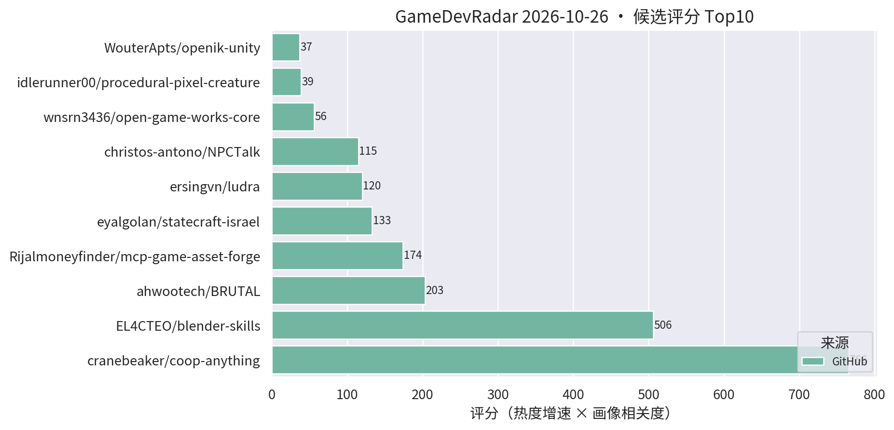
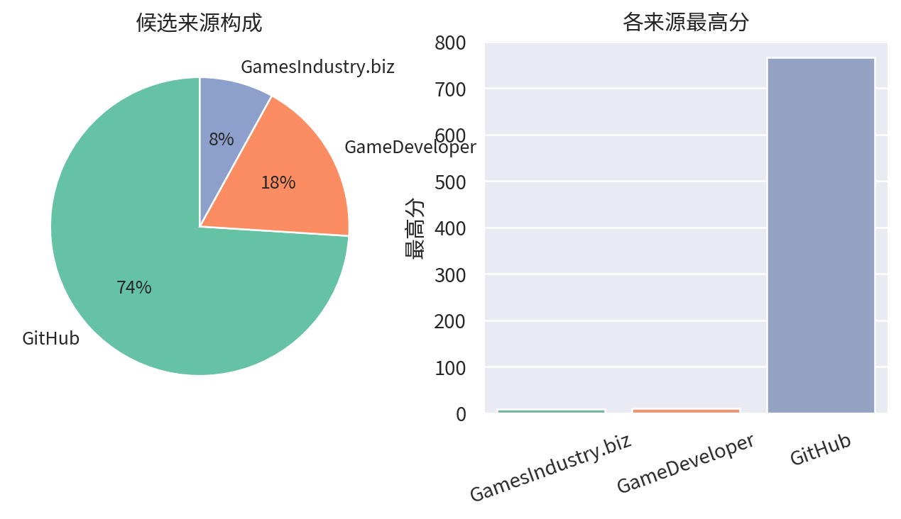

# 游戏开发技术雷达 · 2026-10-26（LLM 点评版）

> 注：今日 Unity Blog / PocketGamer / 80.lv 三个 RSS 源 SSL 失败被跳过，榜单偏 GitHub + GameDeveloper 向，明日自动恢复。

**今日看点**
1. 官方重磅：Unity 发布 Unity Spark——prompt 驱动的游戏开发工具，与 Google AI 游戏平台合作——官方亲自下场 AI 工作流，做 AI 游戏的必看。
2. 新面孔 ludra："为 AI agent 打造的游戏引擎"（游戏即 JSON、报错自带修复方案、agent 无头自测自己的游戏，首日 16★）——AI-native 引擎新物种，概念最激进的一个。
3. coop-anything 1378★/9天 持续领跑、blender-skills 破 500★——agent skill 板块双雄仍未见顶。

| # | 评分 | 项目 / 话题 | 来源 | 信号 | 简介 | 点评 |
|---|---|---|---|---|---|---|
| 1 | 765.55 | [cranebeaker/coop-anything](https://github.com/cranebeaker/coop-anything) | github | 1378★ / 9天 | Co-op Anything: point your AI agent at any single-player game and play it with friends (online and/or splitscreen!). MCP server and playbook to reverse engineer, fix, test, ship and share. | "让 AI agent 把任意单机游戏逆向改造成联机"的 MCP 服务器 + 方法论，九日近 1400★；代表 agent 逆向工作流方向，注意版权边界，看技术思路即可。 |
| 2 | 506.0 | [EL4CTEO/blender-skills](https://github.com/EL4CTEO/blender-skills) | github | 506★ / 11天 | Professional Blender 5.2 workflows as Agent Skills for Claude Code, Codex, Gemini CLI, Copilot and Cursor: modeling, UVs, PBR, baking, rigging, animation, export and QA. | Blender 5.2 专业工作流整体 skill 化（建模/UV/PBR/烘焙/绑定/导出/QA），11 日破 500★；做 TA/资产管线的强烈建议立刻试，AI 工作流直接对口。 |
| 3 | 203.27 | [ahwootech/BRUTAL](https://github.com/ahwootech/BRUTAL) | github | 2236★ / 11天 | A free, open source C# framework for making games, or your own game engine. Direct access to native APIs and Vulkan, with the low-level libraries around them. The foundation under Kitten Space Agency and RimWorld's Waylith engine. | 开源 C# 底层游戏框架：原生 API + Vulkan 直访，RimWorld 新作引擎底座，11 日 2236★；虽非 Unity 插件，但 .NET 游戏开发底座级事件，做引擎/底层的必看。 |
| 4 | 120.0 | [ersingvn/ludra](https://github.com/ersingvn/ludra) | github | 16★ / 1天 | The game engine built for AI agents. Games are JSON, errors come with fixes, and agents play-test their own games headlessly. | "为 AI agent 打造的游戏引擎"：游戏即 JSON、报错自带修复方案、agent 无头自测——AI-native 引擎新物种，概念激进值得跟踪，首日 16★ 尚早。 |
| 5 | 114.95 | [christos-antono/NPCTalk](https://github.com/christos-antono/NPCTalk) | github | 209★ / 10天 | Make any NPC in any game talk back with Fish Audio: skills, a self-hosted voice server and tools for AI coding agents, with a full GTA V example. | 让任意游戏 NPC 开口说话的 agent skill 套件：Fish Audio TTS + 自托管语音服务 + GTA V 完整示例；做 AI NPC/语音交互的值得看，mod 向而非 Unity 工程向。 |
| 6 | 56.25 | [wnsrn3436/open-game-works-core](https://github.com/wnsrn3436/open-game-works-core) | github | 15★ / 2天 | Harness that lets AI agents make server-client games of commercial quality on a prebuilt core. | 让 AI agent 在预制底座上开发"商业品质"服务器-客户端游戏的 harness；"AI 全流程做游戏"又一分支，关注但先观望成色。 |
| 7 | 36.68 | [WouterApts/openik-unity](https://github.com/WouterApts/openik-unity) | github | 89★ / 17天 | Inverse Kinematics package for Unity, featuring multiple solvers, joint limits and procedural animation samples. | Unity IK 包：CCD/FABRIK 多求解器 + 关节限制 + 程序化动画示例；做动画/TA/程序化动作的值得立刻试，真工具无水分。 |
| 8 | 31.88 | [jaisurya-dev-art/rigby2d](https://github.com/jaisurya-dev-art/rigby2d) | github | 45★ / 12天 | Open-source 2D skeletal animation for games, films and interactive experiences. Rig PSD/PNG art, animate, export JSON/.skel + atlas. Runtimes for JavaScript, Rust and Godot 4. Built-in MCP server for AI assistants. | 开源 2D 骨骼动画工具（Spine 路线），内建 MCP server 供 AI 助手调用，导出 .skel 可对接 Spine 管线；暂无 Unity runtime 是硬伤，做 2D/卡牌动画的值得跟踪。 |
| 9 | 23.1 | [TheGreatSimon/AnvilCSG](https://github.com/TheGreatSimon/AnvilCSG) | github | 158★ / 41天 | Anvil CSG Beta 2: a free legacy preview of brush-based level design inside Unity. Hammer-inspired workflow, Built-in and URP. | Hammer 式笔刷关卡设计工具，Built-in/URP 双支持；Unity 关卡白盒刚需，做关卡/TA 的强烈建议试。 |
| 10 | 19.89 | [excifroge/VFX-Essential-Shader](https://github.com/excifroge/VFX-Essential-Shader) | github | 42★ / 19天 | VFX Essential Shader: an all-in-one VFX shader for Unity URP with a custom material inspector. | URP 全家桶 VFX shader + 自定义材质面板，一个材质应付多种特效需求；做手游特效的值得试，小体量项目尤其省事。 |
| 11 | 19.41 | [kanaworksai-hue/effekseer-vfx-skill](https://github.com/kanaworksai-hue/effekseer-vfx-skill) | github | 53★ / 15天 | Agent skills that make real-time game VFX as code for Effekseer and verify them in real Godot renders (Claude Code, Codex and other Agent Skills hosts). | 让 AI agent 用代码编写 Effekseer 实时特效并在引擎内渲染验证的 agent skill；验证基于 Godot，但 Effekseer 可接 Unity，做 VFX/TA + AI 工作流的值得试。 |
| 12 | 17.02 | [UpstandPlatform/OpenRive](https://github.com/UpstandPlatform/OpenRive) | github | 49★ / 33天 | Build interactive UIs, motion, and game experiences in the OpenRive Editor, or let an AI agent generate them through the CLI. | 开源 Rive 替代品，亮点是 AI agent 可用 CLI 直接生成动画 UI；游戏 UI 动效管线 + AI 工作流方向值得跟踪。 |
| 13 | 15.0 | [uilianks/loom](https://github.com/uilianks/loom) | github | 20★ / 4天 | Seamless game textures and PBR materials as code for AI agents: noise, bricks, planks, weathering; albedo/normal/height/roughness/AO/ORM maps, lit previews and a live viewer. | 程序化无缝纹理/PBR 材质"即代码"工具，全贴图组输出 + 实时预览，专为 AI agent 调用设计；引擎无关（贴图可直接进 Unity），做 TA/材质的值得试。 |
| 14 | 12.51 | [zhanglinshuia-code/ZRList](https://github.com/zhanglinshuia-code/ZRList) | github | 75★ / 18天 | Unity uGUI virtualized list and grid components with dynamic sizing, multiple item prefabs, collapsible trees, nested scrolling, and animated navigation. | uGUI 虚拟化列表/网格组件：动态尺寸、多 prefab、折叠树、嵌套滚动一次配齐；做卡牌/背包/列表 UI 的性能刚需，直接对口，建议试。 |
| 15 | 10.5 | [Unity 发布 Unity Spark：面向 Google AI 游戏平台的 prompt 驱动开发工具](https://www.gamedeveloper.com/programming/unity-unveils-unity-spark-an-prompt-based-tool-for-google-s-ai-games-platform) | GameDeveloper | 官方发布 | Unity 新工具支持 prompt 驱动的游戏开发，与 Google AI 合作。 | 官方重磅：Unity 亲自下场 prompt 驱动游戏开发 + 联姻 Google AI 平台——AI 工作流方向最权威的背书，必看。 |

---
*由 GameDevRadar 生成 · 点评由 LLM 按 profile.json 画像撰写 · 原始榜单见 daily.md*
