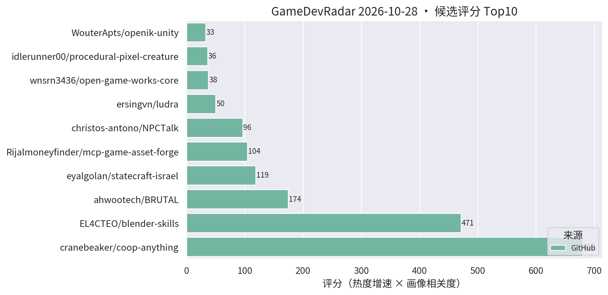
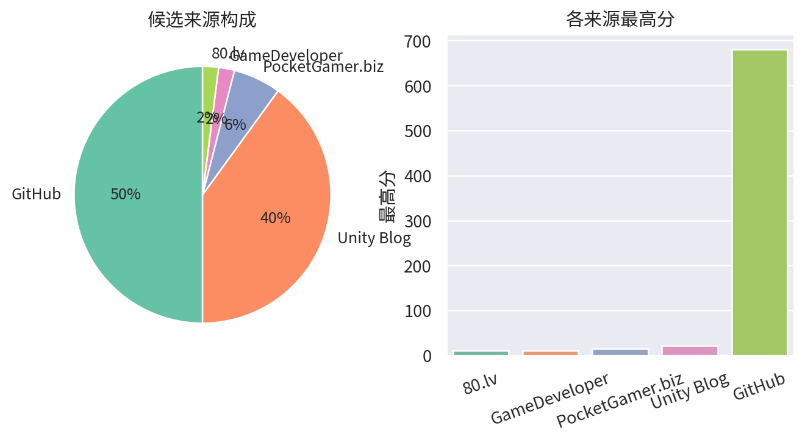

# 游戏开发技术雷达 · 2026-10-28（LLM 点评版）

> 采集于 2026-10-28 10:24 (UTC+8)。reddit r/Unity3D、r/gamedev 与 Unity 论坛照常 403 被拒，已跳过，不影响主榜。

**今日看点**

1. **coop-anything 逼近 1500★（1496★/11天）、BRUTAL 2268★ 稳步上行**——AI agent 改造存量游戏与 .NET 自建引擎底座两条主线继续领跑，热度未见衰减。
2. **两张新面孔同指一条新赛道**：dump-tool（il2cpp 逆向翻译工作台）与 offline-game-revival（停服手游离线化 + 录屏 OCR 抢救数据的 agent skill），都是"AI + 存量游戏资产再加工"方向，值得跟踪其合规边界。
3. **Jeff-FX-forge 带 82 个像素 VFX 预设上榜（43★/6天）**，Godot 工具链"内容预制化"趋势延续，预设 + sprite-sheet 导出的打包思路对 URP 特效侧也有参照价值。

| 评分 | 项目 / 话题 | 来源 | 信号 | 简介 | 点评 |
|---|---|---|---|---|---|
| 680.0 | [cranebeaker/coop-anything](https://github.com/cranebeaker/coop-anything) | github | 1496★ / 11天 | Co-op Anything: point your AI agent at any single-player gam | AI 逆向单机游戏加联机的 MCP，板块龙头持续霸榜；思路对"存量玩法改造"启发极大，商用注意版权边界。 |
| 471.35 | [EL4CTEO/blender-skills](https://github.com/EL4CTEO/blender-skills) | github | 557★ / 13天 | Professional Blender 5.2 workflows as Agent Skills for Claud | 把 Blender 专业工作流封装成 agent skill，DCC 管线 AI 化的样板；TA/资产管线同学强推，看它的 skill 分层设计就值回 5 分钟。 |
| 174.46 | [ahwootech/BRUTAL](https://github.com/ahwootech/BRUTAL) | github | 2268★ / 13天 | A free, open source C# framework for making games, or your o | RimWorld 新作引擎底座的 C# 底层框架（自带 Vulkan 渲染），不是 Unity 插件，但 .NET 游戏底座级事件，关注其内存与渲染架构思路。 |
| 96.25 | [christos-antono/NPCTalk](https://github.com/christos-antono/NPCTalk) | github | 210★ / 12天 | Make any NPC in any game talk back with Fish Audio: skills,  | 用 Fish Audio 让任意游戏 NPC 开口说话的 skill + GTA V 示例；mod 向而非 Unity 工程向，语音 NPC 链路可参考但别指望直接进项目。 |
| 50.02 | [ersingvn/ludra](https://github.com/ersingvn/ludra) | github | 20★ / 3天 | The game engine built for AI agents. Games are JSON, errors  | AI-native 引擎：游戏即 JSON、报错自带修复建议、无头自测；概念激进、星数尚低，保持跟踪观察它能否跑通完整闭环。 |
| 37.5 | [wnsrn3436/open-game-works-core](https://github.com/wnsrn3436/open-game-works-core) | github | 20★ / 4天 | Harness that lets AI agents make server-client games of comm | 让 AI agent 做服务器-客户端架构游戏的 harness；方向新但成色待验，观望。 |
| 32.76 | [WouterApts/openik-unity](https://github.com/WouterApts/openik-unity) | github | 89★ / 19天 | Inverse Kinematics package for Unity, featuring multiple sol | Unity 多求解器 IK 包（CCD/FABRIK 等），真工具无水分；动画/TA 向强推，做角色接地、瞄准姿态都用得上。 |
| 28.68 | [Smidle/Jeff-FX-forge](https://github.com/Smidle/Jeff-FX-forge) | github | 43★ / 6天 | Jeff FX 1.0.1 — Godot 4.7 pixel VFX workshop. 82 presets, sp | Godot 4.7 像素特效工作台，82 个预设 + sprite-sheet 导出 + 场景摆放；引擎不对口但"预设库 + 贴图导出"的打包思路 URP 特效侧可借鉴，趋势级关注。 |
| 28.34 | [jaisurya-dev-art/rigby2d](https://github.com/jaisurya-dev-art/rigby2d) | github | 61★ / 14天 | Open-source 2D skeletal animation editor for games and film. | 走开源 Spine 路线的 2D 骨骼动画编辑器，内建 MCP 可被 AI 驱动；暂缺 Unity runtime 是硬伤，做 2D/卡牌的可以列入观察。 |
| 23.62 | [tcmmm/dump-tool](https://github.com/tcmmm/dump-tool) | github | 54★ / 8天 | il2cpp Dump 翻译工作台 - Unity il2cpp 游戏逆向辅助工具 | il2cpp 逆向分析工作台；对一线开发者的正向价值是自查包体暴露面、评估加固强度，使用时注意合规边界，别用于他人游戏。 |
| 22.2 | [TheGreatSimon/AnvilCSG](https://github.com/TheGreatSimon/AnvilCSG) | github | 159★ / 43天 | Anvil CSG Beta 2: a free legacy preview of brush-based level | Hammer 式笔刷关卡白盒工具（URP 版），做关卡灰盒/原型的强推；Beta 2 是免费 legacy 预览，正式版动向值得跟。 |
| 21.96 | [Cynthia-wlan9509/offline-game-revival](https://github.com/Cynthia-wlan9509/offline-game-revival) | github | 22★ / 9天 | 🎮 AI agent skill that revives shut-down mobile games as full | 停服手游离线化 skill + 录屏抽帧 OCR 抢救游戏数据的零 token 管线；游戏保存向新物种，对自家产品停服资产处理有参考，同样注意版权。 |
| 21.0 | [Scaling Scritchy Scratchy across platforms](https://unity.com/blog/scaling-scritchy-scratchy-across-platforms) | Unity Blog | 官方发布 | Learn how Scritchy Scratchy used Unity to port the game acro | Unity 官方案例：小团队跨平台移植实战；做多端发行的值得看官方总结的坑位清单。 |
| 19.26 | [excifroge/VFX-Essential-Shader](https://github.com/excifroge/VFX-Essential-Shader) | github | 45★ / 21天 | VFX Essential Shader: an all-in-one VFX shader for Unity URP | URP 全家桶特效 shader，溶解/描边/全息一站齐；手游特效偷懒神器，直接拿去改参数就能用。 |
| 18.4 | [UpstandPlatform/OpenRive](https://github.com/UpstandPlatform/OpenRive) | github | 56★ / 35天 | Build inetractive UIs, motion, and game experiences in the O | 开源 Rive 替代路线 + agent CLI；交互动效 UI 方向，做卡牌/运营活动页可关注其成熟度。 |
| 17.49 | [kanaworksai-hue/effekseer-vfx-skill](https://github.com/kanaworksai-hue/effekseer-vfx-skill) | github | 54★ / 17天 | Agent skills that make real-time game VFX as code for Effeks | 把 Effekseer 实时特效变成"特效即代码"的 agent skill；官方验证基于 Godot 但 Effekseer 本身有 Unity runtime，可接。 |

---
*由 GameDevRadar 生成 · 画像配置见 profile.json · 觉得哪类多了/少了就改画像, 别忍着*
