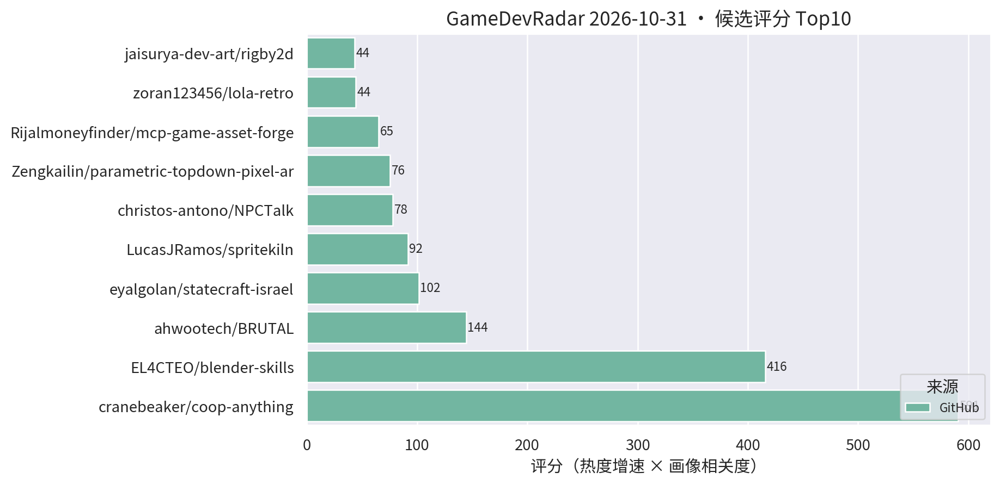
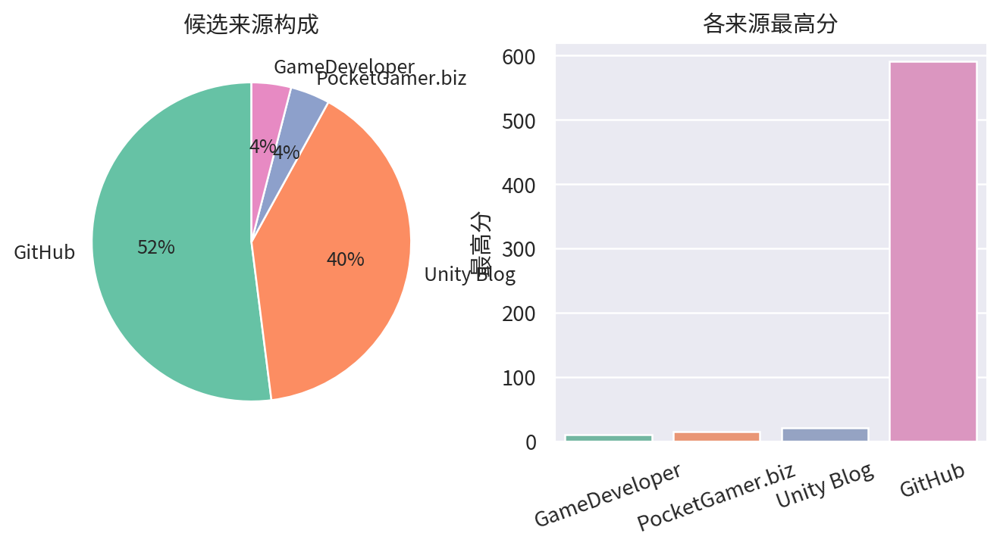

# 游戏开发技术雷达 · 2026-10-31（LLM 点评版）

> 采集于 2026-10-31 10:23 (UTC+8)。reddit r/Unity3D、r/gamedev 与 Unity 论坛照常 403 被拒，已跳过，不影响主榜。

**今日看点**

1. **coop-anything 1654★ 继续领涨，blender-skills 破 600★，BRUTAL 2312★**——三条主线涨幅稳定，板块热度不减。
2. **新面孔 spritekiln（75★/9天）**：YAML 定义程序化 3D 模型、烘焙成 8 方向像素动画精灵，专为 coding AI 驱动设计且**直接导出 Unity**——与昨日的 parametric-topdown-pixel-architecture 凑成"AI 驱动程序生成像素素材"双人组。
3. **创作向工具群持续爬星**：rigby2d 87★、effekseer-vfx-skill 73★、parametric-topdown 55★ 同步上行；dump-tool 今日掉出前 20。

| 评分 | 项目 / 话题 | 来源 | 信号 | 简介 | 点评 |
|---|---|---|---|---|---|
| 590.7 | [cranebeaker/coop-anything](https://github.com/cranebeaker/coop-anything) | github | 1654★ / 14天 | Co-op Anything: point your AI agent at any single-player gam | AI 逆向单机游戏加联机的 MCP，两周冲到 1650+；存量玩法改造思路启发极大，商用注意版权边界。 |
| 415.91 | [EL4CTEO/blender-skills](https://github.com/EL4CTEO/blender-skills) | github | 605★ / 16天 | Professional Blender 5.2 workflows as Agent Skills for Claud | 把 Blender 专业工作流封装成 agent skill，破 600★；TA/资产管线同学强推，skill 分层设计值得抄作业。 |
| 144.5 | [ahwootech/BRUTAL](https://github.com/ahwootech/BRUTAL) | github | 2312★ / 16天 | A free, open source C# framework for making games, or your o | RimWorld 新作引擎底座的 C# 底层框架（自带 Vulkan 渲染），非 Unity 插件但属 .NET 游戏底座级事件，架构思路值得跟。 |
| 91.63 | [LucasJRamos/spritekiln](https://github.com/LucasJRamos/spritekiln) | github | 75★ / 9天 | Animated pixel-art sprites (8-direction top-down or side vie | YAML 写程序化 3D 模型、烘出 8 方向像素精灵动画，专为 coding AI 设计且原生导出 Unity；做像素风卡牌/SLG 的强推，AI 直出可用素材的管线就在眼前。 |
| 78.1 | [christos-antono/NPCTalk](https://github.com/christos-antono/NPCTalk) | github | 213★ / 15天 | Make any NPC in any game talk back with Fish Audio: skills,  | 用 Fish Audio 让任意游戏 NPC 开口说话的 skill；mod 向非 Unity 工程向，语音 NPC 链路可参考，别指望直接进项目。 |
| 75.62 | [Zengkailin/parametric-topdown-pixel-architecture](https://github.com/Zengkailin/parametric-topdown-pixel-architecture) | github | 55★ / 4天 | 参数化2D topdown像素建筑 - 把参数化 3D 建筑渲染成 2D 俯视像素图的本地网页工具（Godot hd2d | 参数化 3D 建筑一键烘成 2D 俯视像素素材的网页工具；引擎无关、本地即用，做 topdown 场景的 5 分钟稳赚。 |
| 44.4 | [zoran123456/lola-retro](https://github.com/zoran123456/lola-retro) | github | 142★ / 16天 | CRT shader for retroarch, unity, kodi, amiberry and 86box | 一份 CRT 滤镜 shader 同时适配 Unity 与多个模拟器平台；做复古像素风手游的直接接入后处理链即可。 |
| 43.52 | [jaisurya-dev-art/rigby2d](https://github.com/jaisurya-dev-art/rigby2d) | github | 87★ / 17天 | Open-source 2D skeletal animation editor for games and film. | 开源 Spine 路线的 2D 骨骼动画编辑器，内建 MCP 可被 AI 驱动；涨速在工具群里领先，暂缺 Unity runtime 是硬伤，继续观察。 |
| 34.67 | [kanaworksai-hue/effekseer-vfx-skill](https://github.com/kanaworksai-hue/effekseer-vfx-skill) | github | 73★ / 20天 | Agent skills that make real-time game VFX: procedural Effeks | 把 Effekseer 实时特效变成"特效即代码"的 agent skill；官方验证基于 Godot 但 Effekseer 有 Unity runtime，特效管线 AI 化可接。 |
| 30.78 | [Cynthia-wlan9509/offline-game-revival](https://github.com/Cynthia-wlan9509/offline-game-revival) | github | 41★ / 12天 | 🎮 AI agent skill that revives shut-down mobile games as full | 停服手游离线化 skill + 录屏抽帧 OCR 抢救数据的零 token 管线；对自家产品停服资产处理有参考，注意版权边界。 |
| 29.97 | [Alone9898/SpineSlim](https://github.com/Alone9898/SpineSlim) | github | 50★ / 15天 | Spine 资源优化与批量处理工具，支持版本转换、纹理压缩和 PC / 移动端资源整理。A desktop toolki | Spine 资源版本转换 + 纹理压缩 + 批量整理桌面工具；2D/卡牌项目资源管线刚需，国产工具文档友好。 |
| 28.63 | [WouterApts/openik-unity](https://github.com/WouterApts/openik-unity) | github | 90★ / 22天 | Inverse Kinematics package for Unity, featuring multiple sol | Unity 多求解器 IK 包（CCD/FABRIK 等），真工具无水分；动画/TA 向强推，角色接地、瞄准姿态场景直接可用。 |
| 24.98 | [ersingvn/ludra](https://github.com/ersingvn/ludra) | github | 20★ / 6天 | The game engine built for AI agents. Games are JSON, errors  | AI-native 引擎概念（游戏即 JSON、报错带修复、无头自测）；星数连续四日停在 20，概念热度退去，降为低频跟踪。 |
| 23.55 | [wnsrn3436/open-game-works-core](https://github.com/wnsrn3436/open-game-works-core) | github | 22★ / 7天 | A harness that lets AI agents make server-client games of co | 让 AI agent 做服务器-客户端架构游戏的 harness；方向新、成色待验，继续观望。 |
| 23.12 | [Smidle/Jeff-FX-forge](https://github.com/Smidle/Jeff-FX-forge) | github | 52★ / 9天 | Jeff FX 1.0.1 — Godot 4.7 pixel VFX workshop. 82 presets, sp | Godot 4.7 像素特效工作台，82 预设 + sprite-sheet 导出；引擎不对口，"预设库 + 贴图导出"思路对 URP 特效侧有参照价值。 |
| 21.0 | [Scaling Scritchy Scratchy across platforms](https://unity.com/blog/scaling-scritchy-scratchy-across-platforms) | Unity Blog | 官方发布 | Learn how Scritchy Scratchy used Unity to port the game acro | Unity 官方小团队跨平台移植实战案例；做多端发行的值得看官方总结的坑位清单。 |

---
*由 GameDevRadar 生成 · 画像配置见 profile.json · 觉得哪类多了/少了就改画像, 别忍着*
