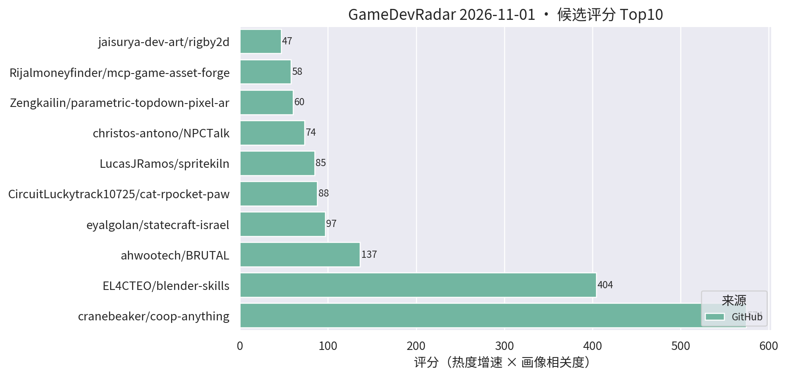
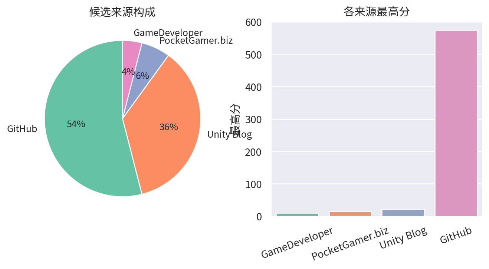

# 游戏开发技术雷达 · 2026-11-01（LLM 点评版）

> 采集于 2026-11-01 10:23 (UTC+8)。reddit r/Unity3D、r/gamedev 与 Unity 论坛照常 403 被拒，已跳过，不影响主榜。

**今日看点**

1. **coop-anything 1723★、blender-skills 625★、BRUTAL 2321★**——三条主线持续稳涨，板块热度进入平台期但未见退潮。
2. **新面孔 LGUI（36★/15天）**：给 AI agent 用的游戏 UI 框架，浏览器里搭界面/逻辑/测试再导出 Unity，FairyGUI/Puerts/TypeScript 技术栈——正中"AI 工作流 × UI"靶心，值得试玩。
3. **rigby2d 逼近 100★（99★）领跑创作工具群**；另一新面孔 cat-rpocket-paw 一天揽 44★，Love2D 三层抽象引擎，趋势级关注即可。

| 评分 | 项目 / 话题 | 来源 | 信号 | 简介 | 点评 |
|---|---|---|---|---|---|
| 574.35 | [cranebeaker/coop-anything](https://github.com/cranebeaker/coop-anything) | github | 1723★ / 15天 | Co-op Anything: point your AI agent at any single-player gam | AI 逆向单机游戏加联机的 MCP，半月冲到 1700+；存量玩法改造思路启发极大，商用注意版权边界。 |
| 404.36 | [EL4CTEO/blender-skills](https://github.com/EL4CTEO/blender-skills) | github | 625★ / 17天 | Professional Blender 5.2 workflows as Agent Skills for Claud | 把 Blender 专业工作流封装成 agent skill，DCC 管线 AI 化样板；TA/资产管线同学强推，skill 分层设计值得抄作业。 |
| 136.53 | [ahwootech/BRUTAL](https://github.com/ahwootech/BRUTAL) | github | 2321★ / 17天 | A free, open source C# framework for making games, or your o | RimWorld 新作引擎底座的 C# 底层框架（自带 Vulkan 渲染），非 Unity 插件但属 .NET 游戏底座级事件，架构思路值得跟。 |
| 88.0 | [CircuitLuckytrack10725/cat-rpocket-paw](https://github.com/CircuitLuckytrack10725/cat-rpocket-paw) | github | 44★ / 1天 | A 2D game development engine written on top of Love2D offeri | Love2D 之上的 2D 引擎，三层抽象 + 保留模式 GUI + 场景编辑器；一天 44★ 起势猛，但 Love2D 生态离商用手游较远，趋势级看一眼即可。 |
| 84.7 | [LucasJRamos/spritekiln](https://github.com/LucasJRamos/spritekiln) | github | 77★ / 10天 | Animated pixel-art sprites (8-direction top-down or side vie | YAML 写程序化 3D 模型、烘出 8 方向像素精灵动画，专为 coding AI 设计且原生导出 Unity；做像素风卡牌/SLG 的强推。 |
| 73.59 | [christos-antono/NPCTalk](https://github.com/christos-antono/NPCTalk) | github | 214★ / 16天 | Make any NPC in any game talk back with Fish Audio: skills,  | 用 Fish Audio 让任意游戏 NPC 开口说话的 skill；mod 向非 Unity 工程向，语音 NPC 链路可参考，别指望直接进项目。 |
| 60.5 | [Zengkailin/parametric-topdown-pixel-architecture](https://github.com/Zengkailin/parametric-topdown-pixel-architecture) | github | 55★ / 5天 | 参数化2D topdown像素建筑 - 把参数化 3D 建筑渲染成 2D 俯视像素图的本地网页工具（Godot hd2d | 参数化 3D 建筑一键烘成 2D 俯视像素素材的网页工具；引擎无关、本地即用，做 topdown 场景的 5 分钟稳赚。 |
| 46.75 | [jaisurya-dev-art/rigby2d](https://github.com/jaisurya-dev-art/rigby2d) | github | 99★ / 18天 | Open-source 2D skeletal animation editor for games and film. | 开源 Spine 路线的 2D 骨骼动画编辑器，内建 MCP 可被 AI 驱动；逼近 100★ 领跑工具群，暂缺 Unity runtime 是硬伤，继续观察。 |
| 42.05 | [zoran123456/lola-retro](https://github.com/zoran123456/lola-retro) | github | 143★ / 17天 | CRT shader for retroarch, unity, kodi, amiberry and 86box | 一份 CRT 滤镜 shader 同时适配 Unity 与多个模拟器平台；做复古像素风手游的直接接入后处理链即可。 |
| 33.44 | [kanaworksai-hue/effekseer-vfx-skill](https://github.com/kanaworksai-hue/effekseer-vfx-skill) | github | 74★ / 21天 | Agent skills that make real-time game VFX: procedural Effeks | 把 Effekseer 实时特效变成"特效即代码"的 agent skill；官方验证基于 Godot 但 Effekseer 有 Unity runtime，特效管线 AI 化可接。 |
| 33.21 | [Cynthia-wlan9509/offline-game-revival](https://github.com/Cynthia-wlan9509/offline-game-revival) | github | 48★ / 13天 | 🎮 AI agent skill that revives shut-down mobile games as full | 停服手游离线化 skill + 录屏抽帧 OCR 抢救数据的零 token 管线；对自家产品停服资产处理有参考，注意版权边界。 |
| 28.08 | [Alone9898/SpineSlim](https://github.com/Alone9898/SpineSlim) | github | 50★ / 16天 | Spine 资源优化与批量处理工具，支持版本转换、纹理压缩和 PC / 移动端资源整理。A desktop toolki | Spine 资源版本转换 + 纹理压缩 + 批量整理桌面工具；2D/卡牌项目资源管线刚需，国产工具文档友好。 |
| 27.09 | [WouterApts/openik-unity](https://github.com/WouterApts/openik-unity) | github | 89★ / 23天 | Inverse Kinematics package for Unity, featuring multiple sol | Unity 多求解器 IK 包（CCD/FABRIK 等），真工具无水分；动画/TA 向强推，角色接地、瞄准姿态场景直接可用。 |
| 21.6 | [Smidle/Jeff-FX-forge](https://github.com/Smidle/Jeff-FX-forge) | github | 54★ / 10天 | Jeff FX 1.0.1 — Godot 4.7 pixel VFX workshop. 82 presets, sp | Godot 4.7 像素特效工作台，82 预设 + sprite-sheet 导出；引擎不对口，"预设库 + 贴图导出"思路对 URP 特效侧有参照价值。 |
| 21.6 | [LumioGames/LGUI](https://github.com/LumioGames/LGUI) | github | 36★ / 15天 | Game UI framework for AI agents, made by LumioGames. Build s | 给 AI agent 用的游戏 UI 框架：浏览器里搭界面/逻辑/测试再导出 Unity，FairyGUI/Puerts 技术栈；做 UI 自动化的值得第一时间试玩。 |
| 21.45 | [ersingvn/ludra](https://github.com/ersingvn/ludra) | github | 20★ / 7天 | The game engine built for AI agents. Games are JSON, errors  | AI-native 引擎概念（游戏即 JSON、报错带修复、无头自测）；星数连续五日停在 20，概念热度退去，降为低频跟踪。 |

---
*由 GameDevRadar 生成 · 画像配置见 profile.json · 觉得哪类多了/少了就改画像, 别忍着*
