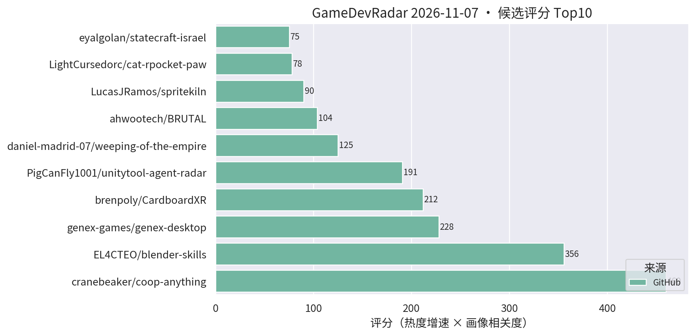
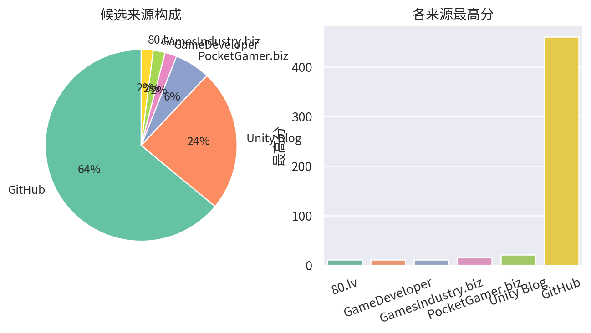

# 游戏开发技术雷达 · 2026-11-07（LLM 点评版）

> 采集于 2026-11-07 10:23 (UTC+8)。reddit/Unity 论坛照常 403，已跳过，不影响主榜。

**今日看点**

1. **coop-anything 1932★ 距 2000 一步之遥**，blender-skills 744★、genex-desktop 798★ 紧随其后——AI 开发工具头部格局趋于稳定。
2. **CardboardXR 八连涨至 242★**，是近期增速最稳的新面孔；spritekiln 131★、rigby2d 161★、oni-moono 146★ 全线爬升。
3. **昨日两条可疑仓仍在榜**（链上雷达、换号重发的 Love2D 引擎），引流仓未退场，继续剔除。

| 评分 | 项目 / 话题 | 来源 | 信号 | 简介 | 点评 |
|---|---|---|---|---|---|
| 460.0 | [cranebeaker/coop-anything](https://github.com/cranebeaker/coop-anything) | github | 1932★ / 21天 | Co-op Anything: point your AI agent at any single-player gam | AI 逆向单机游戏加联机的 MCP，距 2000★ 一步之遥；存量玩法改造思路启发极大，商用注意版权边界。 |
| 355.85 | [EL4CTEO/blender-skills](https://github.com/EL4CTEO/blender-skills) | github | 744★ / 23天 | Professional Blender 5.2 workflows as Agent Skills for Claud | 把 Blender 专业工作流封装成 agent skill，DCC 管线 AI 化样板；TA/资产管线同学强推，skill 分层设计值得抄作业。 |
| 228.0 | [genex-games/genex-desktop](https://github.com/genex-games/genex-desktop) | github | 798★ / 35天 | Desktop app for game dev with AI: make games in Unreal Engin | AI 桌面应用：agent 自己装引擎、搭游戏、跑自测，支持 Unity/Unreal/Godot/浏览器；逼近 800★，赛道第一梯队。 |
| 211.75 | [brenpoly/CardboardXR](https://github.com/brenpoly/CardboardXR) | github | 242★ / 8天 | Mobile VR with 6DoF head tracking, passthrough and hand trac | 用 ARCore/ARKit 给手机 VR 补 6DoF/透视/手势的 Unity 插件，八连涨；做 XR 玩法验证不用再等 Quest。 |
| 103.83 | [ahwootech/BRUTAL](https://github.com/ahwootech/BRUTAL) | github | 2388★ / 23天 | A free, open source C# framework for making games, or your o | RimWorld 新作引擎底座的 C# 底层框架（自带 Vulkan 渲染）；.NET 底座价值持续兑现，架构思路值得跟。 |
| 90.09 | [LucasJRamos/spritekiln](https://github.com/LucasJRamos/spritekiln) | github | 131★ / 16天 | Animated pixel-art sprites (8-direction top-down or side vie | YAML 写程序化 3D 模型、烘出 8 方向像素精灵动画，专为 coding AI 设计且原生导出 Unity；持续加速，做像素风卡牌/SLG 的强推。 |
| 57.03 | [jaisurya-dev-art/rigby2d](https://github.com/jaisurya-dev-art/rigby2d) | github | 161★ / 24天 | Open-source 2D skeletal animation editor for games and film. | 开源 Spine 路线的 2D 骨骼动画编辑器，内建 MCP 可被 AI 驱动；涨势不减，暂缺 Unity runtime 是硬伤，继续观察。 |
| 55.28 | [christos-antono/NPCTalk](https://github.com/christos-antono/NPCTalk) | github | 221★ / 22天 | Make any NPC in any game talk back with Fish Audio: skills,  | 用 Fish Audio 让任意游戏 NPC 开口说话的 skill；mod 向非 Unity 工程向，语音 NPC 链路可参考，别指望直接进项目。 |
| 54.53 | [kanaworksai-hue/effekseer-vfx-skill](https://github.com/kanaworksai-hue/effekseer-vfx-skill) | github | 155★ / 27天 | Agent skills that make real-time game VFX: procedural Effeks | "特效即代码" agent skill 站稳翻倍成果；官方验证基于 Godot 但 Effekseer 有 Unity runtime，特效管线 AI 化值得跟进。 |
| 47.16 | [LumioGames/LGUI](https://github.com/LumioGames/LGUI) | github | 110★ / 21天 | Game UI framework for AI agents, made by LumioGames. Build s | 给 AI agent 用的游戏 UI 框架：浏览器搭界面/逻辑/测试再导出 Unity，FairyGUI/Puerts 技术栈；破百后稳涨，做 UI 自动化的抓紧试玩。 |
| 36.0 | [Cynthia-wlan9509/offline-game-revival](https://github.com/Cynthia-wlan9509/offline-game-revival) | github | 76★ / 19天 | 🎮 AI agent skill that revives shut-down mobile games as full | 停服手游离线化 skill + 录屏抽帧 OCR 抢救数据的零 token 管线；对自家产品停服资产处理有参考，注意版权边界。 |
| 35.65 | [zoran123456/lola-retro](https://github.com/zoran123456/lola-retro) | github | 164★ / 23天 | CRT shader for retroarch, unity, kodi, amiberry and 86box | 一份 CRT 滤镜 shader 同时适配 Unity 与多个模拟器平台；做复古像素风手游的直接接入后处理链即可。 |
| 33.2 | [tigin-backwards/oni-moono](https://github.com/tigin-backwards/oni-moono) | github | 146★ / 22天 | Oxygen Not Included's Unity layer on the BRUTAL framework, . | ONI 的 Unity 层迁到 BRUTAL + .NET 10 CoreCLR，后期殖民地约 8× 帧率；做性能优化/CoreCLR 迁移的活教材，强推一读。 |
| 32.01 | [Zengkailin/parametric-topdown-pixel-architecture](https://github.com/Zengkailin/parametric-topdown-pixel-architecture) | github | 64★ / 11天 | 参数化2D topdown像素建筑 - 把参数化 3D 建筑渲染成 2D 俯视像素图的本地网页工具（Godot hd2d | 参数化 3D 建筑一键烘成 2D 俯视像素素材的网页工具；引擎无关、本地即用，做 topdown 场景的 5 分钟稳赚。 |

---
*由 GameDevRadar 生成 · 画像配置见 profile.json · 觉得哪类多了/少了就改画像, 别忍着*
