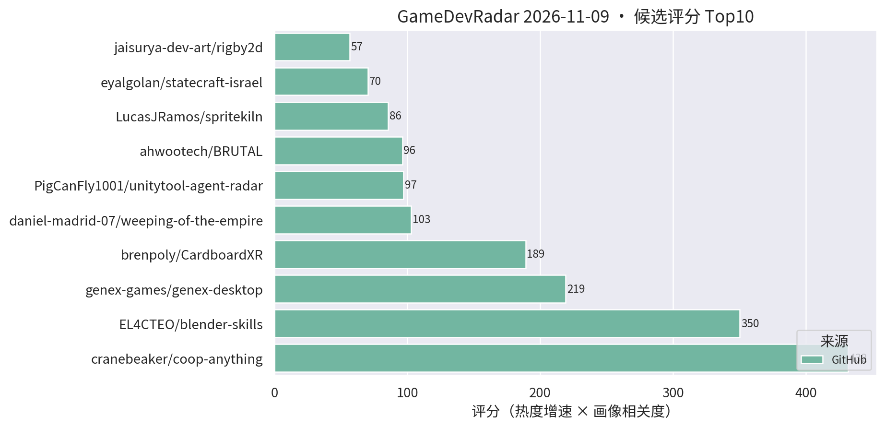
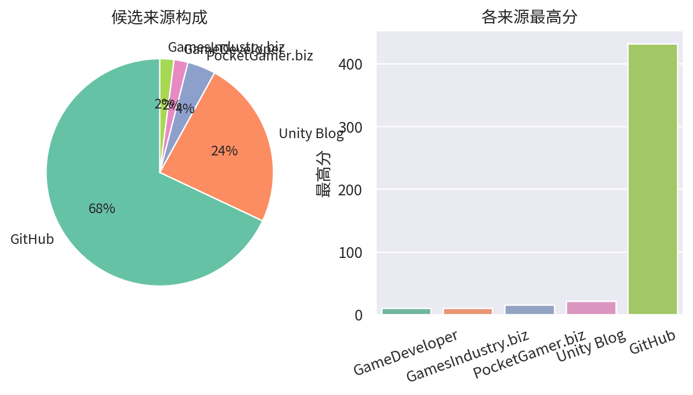

# 游戏开发技术雷达 · 2026-11-09（LLM 点评版）

> 采集于 2026-11-09 10:23 (UTC+8)。reddit/Unity 论坛照常 403，已跳过，不影响主榜。

**今日看点**

1. **coop-anything 1986★ 明日大概率破 2000**；blender-skills 796★、genex-desktop 811★——AI 开发工具三巨头齐头并进。
2. **parametric-topdown-pixel-architecture 一天 64→101★ 翻倍破百**——程序生成像素素材管线被集中发现，与 spritekiln 形成"AI 像素素材双雄"。
3. **新面孔 polyspoon（85★/13天）**：AI 生成 + 人工审核的开源 3D 素材社区，可编辑模型直出 Unity/Godot，原型期占位素材的新来源。

| 评分 | 项目 / 话题 | 来源 | 信号 | 简介 | 点评 |
|---|---|---|---|---|---|
| 431.75 | [cranebeaker/coop-anything](https://github.com/cranebeaker/coop-anything) | github | 1986★ / 23天 | Co-op Anything: point your AI agent at any single-player gam | AI 逆向单机游戏加联机的 MCP，23 天摸到 2000★ 门槛；存量玩法改造思路启发极大，商用注意版权边界。 |
| 350.24 | [EL4CTEO/blender-skills](https://github.com/EL4CTEO/blender-skills) | github | 796★ / 25天 | Professional Blender 5.2 workflows as Agent Skills for Claud | 把 Blender 专业工作流封装成 agent skill，逼近 800★；TA/资产管线同学强推，skill 分层设计值得抄作业。 |
| 219.2 | [genex-games/genex-desktop](https://github.com/genex-games/genex-desktop) | github | 811★ / 37天 | Desktop app for game dev with AI: make games in Unreal Engin | AI 桌面应用：agent 自己装引擎、搭游戏、跑自测，支持 Unity/Unreal/Godot/浏览器；破 800★，赛道第一梯队。 |
| 189.0 | [brenpoly/CardboardXR](https://github.com/brenpoly/CardboardXR) | github | 270★ / 10天 | Mobile VR with 6DoF head tracking, passthrough and hand trac | 用 ARCore/ARKit 给手机 VR 补 6DoF/透视/手势的 Unity 插件，十连涨；做 XR 玩法验证不用再等 Quest。 |
| 96.2 | [ahwootech/BRUTAL](https://github.com/ahwootech/BRUTAL) | github | 2405★ / 25天 | A free, open source C# framework for making games, or your o | RimWorld 新作引擎底座的 C# 底层框架（自带 Vulkan 渲染）；破 2400★，.NET 底座价值持续兑现。 |
| 85.58 | [LucasJRamos/spritekiln](https://github.com/LucasJRamos/spritekiln) | github | 140★ / 18天 | Animated pixel-art sprites (8-direction top-down or side vie | YAML 写程序化 3D 模型、烘出 8 方向像素精灵动画，专为 coding AI 设计且原生导出 Unity；做像素风卡牌/SLG 的强推。 |
| 56.53 | [jaisurya-dev-art/rigby2d](https://github.com/jaisurya-dev-art/rigby2d) | github | 173★ / 26天 | Open-source 2D skeletal animation editor for games and film. | 开源 Spine 路线的 2D 骨骼动画编辑器，内建 MCP 可被 AI 驱动；涨势不减，暂缺 Unity runtime 是硬伤，继续观察。 |
| 52.25 | [christos-antono/NPCTalk](https://github.com/christos-antono/NPCTalk) | github | 228★ / 24天 | Make any NPC in any game talk back with Fish Audio: skills,  | 用 Fish Audio 让任意游戏 NPC 开口说话的 skill；mod 向非 Unity 工程向，语音 NPC 链路可参考，别指望直接进项目。 |
| 52.06 | [kanaworksai-hue/effekseer-vfx-skill](https://github.com/kanaworksai-hue/effekseer-vfx-skill) | github | 159★ / 29天 | Agent skills that make real-time game VFX: procedural Effeks | "特效即代码" agent skill 稳步上行；官方验证基于 Godot 但 Effekseer 有 Unity runtime，特效管线 AI 化值得跟进。 |
| 45.0 | [LumioGames/LGUI](https://github.com/LumioGames/LGUI) | github | 115★ / 23天 | Game UI framework for AI agents, made by LumioGames. Build s | 给 AI agent 用的游戏 UI 框架：浏览器搭界面/逻辑/测试再导出 Unity，FairyGUI/Puerts 技术栈；做 UI 自动化的抓紧试玩。 |
| 42.73 | [Zengkailin/parametric-topdown-pixel-architecture](https://github.com/Zengkailin/parametric-topdown-pixel-architecture) | github | 101★ / 13天 | 参数化2D topdown像素建筑 - 把参数化 3D 建筑渲染成 2D 俯视像素图的本地网页工具（Godot hd2d | 参数化 3D 建筑一键烘成 2D 俯视像素素材的网页工具；单日翻倍破百，做 topdown 场景的 5 分钟稳赚。 |
| 35.55 | [Cynthia-wlan9509/offline-game-revival](https://github.com/Cynthia-wlan9509/offline-game-revival) | github | 83★ / 21天 | 🎮 AI agent skill that revives shut-down mobile games as full | 停服手游离线化 skill + 录屏抽帧 OCR 抢救数据的零 token 管线；对自家产品停服资产处理有参考，注意版权边界。 |
| 34.4 | [tigin-backwards/oni-moono](https://github.com/tigin-backwards/oni-moono) | github | 165★ / 24天 | Oxygen Not Included's Unity layer on the BRUTAL framework, . | ONI 的 Unity 层迁到 BRUTAL + .NET 10 CoreCLR，后期殖民地约 8× 帧率；做性能优化/CoreCLR 迁移的活教材，强推一读。 |
| 33.2 | [zoran123456/lola-retro](https://github.com/zoran123456/lola-retro) | github | 166★ / 25天 | CRT shader for retroarch, unity, kodi, amiberry and 86box | 一份 CRT 滤镜 shader 同时适配 Unity 与多个模拟器平台；做复古像素风手游的直接接入后处理链即可。 |
| 26.16 | [DITlieD/polyspoon](https://github.com/DITlieD/polyspoon) | github | 85★ / 13天 | Polyspoon: an open-source, AI-powered 3D asset community. Tu | AI 生成 + 人工审核的开源 3D 素材社区，"配方"生成可编辑模型直出 Unity/Godot；低模起步，做原型占位素材值得关注。 |

---
*由 GameDevRadar 生成 · 画像配置见 profile.json · 觉得哪类多了/少了就改画像, 别忍着*
