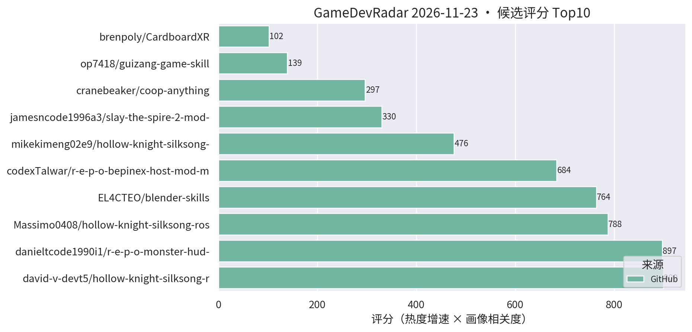
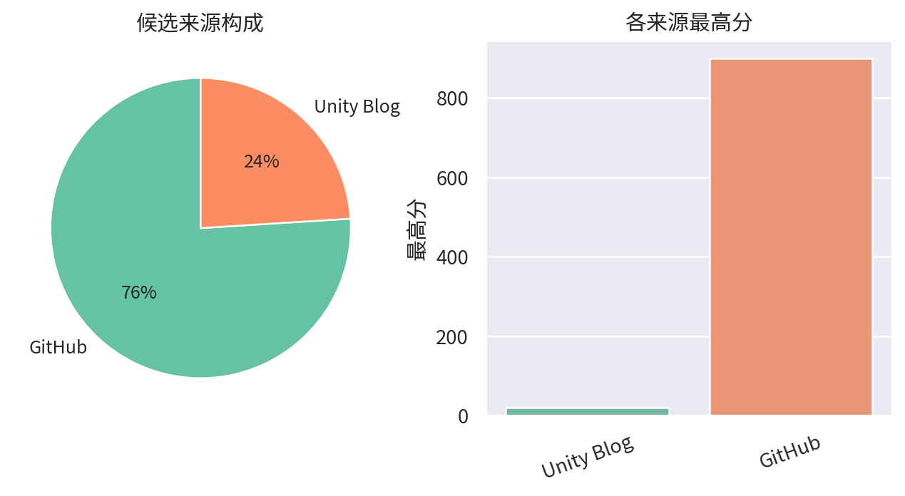

# 游戏开发技术雷达 · 2026-11-23（LLM 点评版）

> 采集于 2026-11-23 10:23 (UTC+8)。reddit/Unity 论坛照常 403，已跳过，不影响主榜。

**今日看点**

1. **blender-skills 2708★ 继续领涨**，单日 +85；coop-anything 2195★ 横盘第七日，头部差距拉大到 500+。
2. **SEO 刷量升级**：修改器家族新增 veceren/nolelin 后缀变体，共 6 个仓霸占前 7、占榜单三成，全部按外挂/修改器口径剔除——脚本侧或许该考虑加"portable-x64/随机后缀"关键词过滤了。
3. **rigby2d 340★、parametric-topdown 243★、BRUTAL 2542★** 稳涨，真工具群不受刷量影响。

| 评分 | 项目 / 话题 | 来源 | 信号 | 简介 | 点评 |
|---|---|---|---|---|---|
| 763.84 | [EL4CTEO/blender-skills](https://github.com/EL4CTEO/blender-skills) | github | 2708★ / 39天 | Professional Blender 5.3 workflows as Agent Skills for Claud | 把 Blender 专业工作流封装成 agent skill，单日 +85 继续领涨；DCC 管线 AI 化头号样板，TA/资产管线必看。 |
| 296.6 | [cranebeaker/coop-anything](https://github.com/cranebeaker/coop-anything) | github | 2195★ / 37天 | Co-op Anything: point your AI agent at any single-player gam | AI 逆向单机游戏加联机的 MCP，横盘第七日；存量玩法改造思路启发极大，商用注意版权边界。 |
| 139.37 | [op7418/guizang-game-skill](https://github.com/op7418/guizang-game-skill) | github | 438★ / 11天 | 歸藏 Game Skill：让 AI 从零做出能在浏览器里玩的 3D 动作游戏，附可玩演示《雾锁山门》。Agent sk | 歸藏出品的 agent skill：three.js 单 HTML + Tripo AI 素材直出可玩 3D 动作游戏；"从零到可玩"的 skill 编排是 AI 工作流最强样板，必拆。 |
| 102.06 | [brenpoly/CardboardXR](https://github.com/brenpoly/CardboardXR) | github | 350★ / 24天 | Mobile VR with 6DoF head tracking, passthrough and hand trac | 用 ARCore/ARKit 给手机 VR 补 6DoF/透视/手势的 Unity 插件；做 XR 玩法验证不用再等 Quest。 |
| 72.88 | [rtmandreyev/construct](https://github.com/rtmandreyev/construct) | github | 169★ / 29天 | Persistent, editable objects for AI agents: researched part  | 给 AI agent 的持久可编辑对象系统：逐部件研究、来源溯源，可带入游戏/影视/CAD/3D 打印；agent 基础设施新思路，TA/程序化管线值得看。 |
| 72.25 | [jaisurya-dev-art/rigby2d](https://github.com/jaisurya-dev-art/rigby2d) | github | 340★ / 40天 | Open-source 2D skeletal animation editor for games and film. | 开源 Spine 路线的 2D 骨骼动画编辑器，内建 MCP 可被 AI 驱动；稳涨至 340★，暂缺 Unity runtime 是硬伤，继续观察。 |
| 65.18 | [ahwootech/BRUTAL](https://github.com/ahwootech/BRUTAL) | github | 2542★ / 39天 | A free, open source C# framework for making games, or your o | RimWorld 新作引擎底座的 C# 底层框架（自带 Vulkan 渲染）；.NET 底座价值持续兑现，架构思路值得跟。 |
| 60.83 | [LucasJRamos/spritekiln](https://github.com/LucasJRamos/spritekiln) | github | 177★ / 32天 | Animated pixel-art sprites (8-direction top-down or side vie | YAML 写程序化 3D 模型、烘出 8 方向像素精灵动画，专为 coding AI 设计且原生导出 Unity；做像素风卡牌/SLG 的强推。 |
| 49.5 | [Zengkailin/parametric-topdown-pixel-architecture](https://github.com/Zengkailin/parametric-topdown-pixel-architecture) | github | 243★ / 27天 | 参数化2D topdown像素建筑 - 把参数化 3D 建筑渲染成 2D 俯视像素图的本地网页工具（Godot hd2d | 参数化 3D 建筑一键烘成 2D 俯视像素素材的网页工具；引擎无关、本地即用，做 topdown 场景的 5 分钟稳赚。 |
| 39.99 | [kanaworksai-hue/effekseer-vfx-skill](https://github.com/kanaworksai-hue/effekseer-vfx-skill) | github | 181★ / 43天 | Agent skills that make real-time game VFX: procedural Effeks | "特效即代码" agent skill 稳步上行；官方验证基于 Godot 但 Effekseer 有 Unity runtime，特效管线 AI 化值得跟进。 |

---
*由 GameDevRadar 生成 · 画像配置见 profile.json · 觉得哪类多了/少了就改画像, 别忍着*
