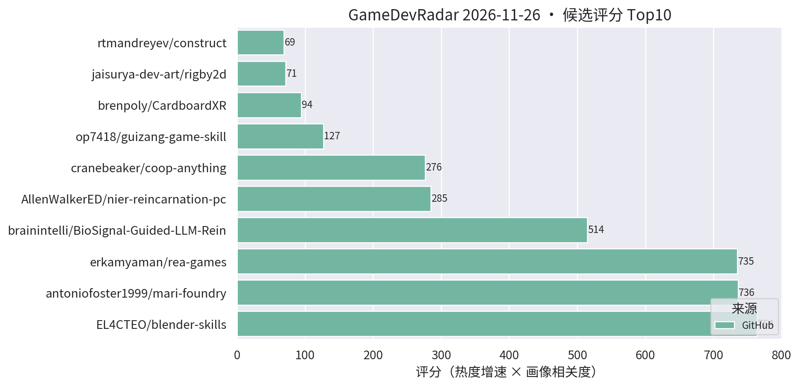
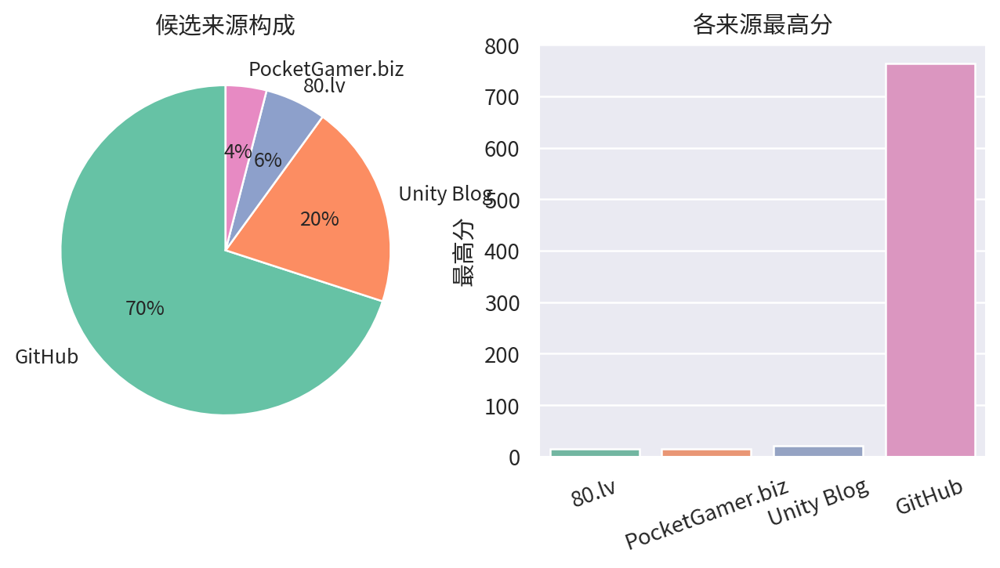

# 游戏开发技术雷达 · 2026-11-26（LLM 点评版）

> 采集于 2026-11-26 10:23 (UTC+8)。reddit/Unity 论坛照常 403，已跳过，不影响主榜；今日原始候选 327 条。

**今日看点**

1. **blender-skills 2916★ 突破 2900**，连续领涨；guizang-game-skill 507★ 破 500——agent skill 化工作流仍是本周最确定的趋势。
2. **新冒头两只单日高星仓均有猫腻**：mari-foundry（184★/1天）疑似 SEO 刷量、rea-games（210★/1天）主打"逆向任何游戏"，连同回潮的 BioSignal-RL 刷量仓一并剔除。
3. **中期工具稳中有升**：rigby2d 361★、oni-moono 284★、CardboardXR 363★、LGUI 165★ 缓涨；AI-All-Round-Bench 155★ 升温，agent 测评值得对照。

| 评分 | 项目 / 话题 | 来源 | 信号 | 简介 | 点评 |
|---|---|---|---|---|---|
| 763.73 | [EL4CTEO/blender-skills](https://github.com/EL4CTEO/blender-skills) | github | 2916★ / 42天 | Professional Blender 5.3 workflows as Agent Skills for Claud | 把 Blender 专业工作流封装成 agent skill，突破 2900★ 继续领涨；DCC 管线 AI 化头号样板，TA/资产管线必看。 |
| 276.15 | [cranebeaker/coop-anything](https://github.com/cranebeaker/coop-anything) | github | 2209★ / 40天 | Co-op Anything: point your AI agent at any single-player gam | AI 逆向单机游戏加联机的 MCP，横盘第十日；存量玩法改造思路启发极大，商用注意版权边界。 |
| 126.73 | [op7418/guizang-game-skill](https://github.com/op7418/guizang-game-skill) | github | 507★ / 14天 | 歸藏 Game Skill：让 AI 从零做出能在浏览器里玩的 3D 动作游戏，附可玩演示《雾锁山门》。Agent sk | 歸藏出品的 agent skill：three.js 单 HTML + AI 素材直出可玩 3D 动作游戏，破 500★；"从零到可玩"的 skill 编排是 AI 工作流最强样板，必拆。 |
| 94.08 | [brenpoly/CardboardXR](https://github.com/brenpoly/CardboardXR) | github | 363★ / 27天 | Mobile VR with 6DoF head tracking, passthrough and hand trac | 用 ARCore/ARKit 给手机 VR 补 6DoF/透视/手势的 Unity 插件；做 XR 玩法验证不用再等 Quest，移动端原型利器。 |
| 71.4 | [jaisurya-dev-art/rigby2d](https://github.com/jaisurya-dev-art/rigby2d) | github | 361★ / 43天 | Open-source 2D skeletal animation editor for games and film. | 开源 Spine 路线的 2D 骨骼动画编辑器，内建 MCP 可被 AI 驱动；稳步缓涨，暂缺 Unity runtime 是硬伤，继续观察。 |
| 69.12 | [rtmandreyev/construct](https://github.com/rtmandreyev/construct) | github | 177★ / 32天 | Persistent, editable objects for AI agents: researched part  | 给 AI agent 的持久可编辑对象系统：逐部件研究、来源溯源，可带入游戏/影视/CAD；agent 基础设施新思路，TA/程序化管线值得看。 |
| 60.88 | [ahwootech/BRUTAL](https://github.com/ahwootech/BRUTAL) | github | 2557★ / 42天 | A free, open source C# framework for making games, or your o | RimWorld 新作引擎底座的 C# 底层框架（自带 Vulkan 渲染）；.NET 底座价值持续兑现，架构思路值得跟。 |
| 56.54 | [LucasJRamos/spritekiln](https://github.com/LucasJRamos/spritekiln) | github | 180★ / 35天 | Animated pixel-art sprites (8-direction top-down or side vie | YAML 写程序化 3D 模型、烘出 8 方向像素精灵动画，专为 coding AI 设计且原生导出 Unity；做像素风卡牌/SLG 的强推。 |
| 45.48 | [Zengkailin/parametric-topdown-pixel-architecture](https://github.com/Zengkailin/parametric-topdown-pixel-architecture) | github | 248★ / 30天 | 参数化2D topdown像素建筑 - 把参数化 3D 建筑渲染成 2D 俯视像素图的本地网页工具（Godot hd2d | 参数化 3D 建筑一键烘成 2D 俯视像素素材的网页工具；引擎无关、本地即用，做 topdown 场景的 5 分钟稳赚。 |
| 37.08 | [LumioGames/LGUI](https://github.com/LumioGames/LGUI) | github | 165★ / 40天 | Game UI framework for AI agents, made by LumioGames. Build s | 给 AI agent 用的游戏 UI 框架：浏览器搭界面/逻辑/测试再导出 Unity，FairyGUI/Puerts 技术栈；做 UI 自动化的抓紧试玩。 |
| 36.3 | [Wendystar0628/AI-All-Round-Bench](https://github.com/Wendystar0628/AI-All-Round-Bench) | github | 155★ / 32天 | AI全能测评 \| AI All-Round Bench: timed challenge benchmarks for | AI coding agent 限时挑战基准（含游戏 AI、3D/web 应用等 10 类任务）；非游戏工具，但评估手头 agent 实战能力时值得对照，趋势级。 |
| 34.65 | [tigin-backwards/oni-moono](https://github.com/tigin-backwards/oni-moono) | github | 284★ / 41天 | Oxygen Not Included's Unity layer on the BRUTAL framework, . | ONI 的 Unity 层迁到 BRUTAL + CoreCLR，后期殖民地约 8× 帧率；做性能优化/CoreCLR 迁移的活教材，强推一读。 |
| 31.41 | [christos-antono/NPCTalk](https://github.com/christos-antono/NPCTalk) | github | 234★ / 41天 | Make any NPC in any game talk back with Fish Audio: skills,  | 用 Fish Audio 让任意游戏 NPC 开口说话的 skill；mod 向非 Unity 工程向，语音 NPC 链路可参考，别指望直接进项目。 |

---
*由 GameDevRadar 生成 · 画像配置见 profile.json · 觉得哪类多了/少了就改画像, 别忍着*
