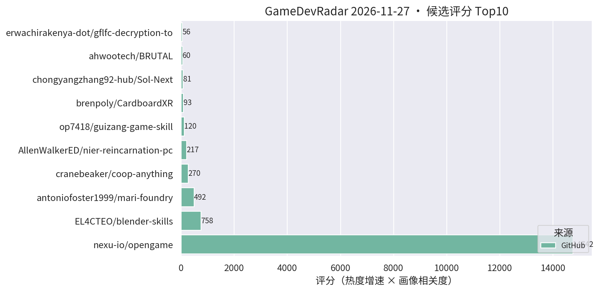
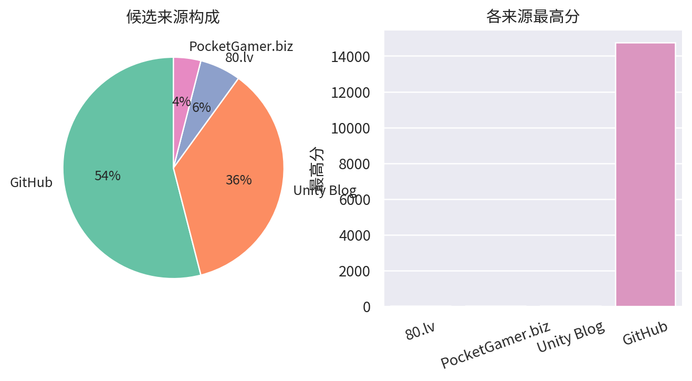

# 游戏开发技术雷达 · 2026-11-27（LLM 点评版）

> 采集于 2026-11-27 10:23 (UTC+8)。reddit/Unity 论坛照常 403、github 'godot' 查询超时，已跳过，不影响主榜；今日原始候选 303 条。

**今日看点**

1. **nexu-io/opengame 单日 1053★ 空降榜首**——自称"AI agent 的 Unity & Unreal"、直发微信/抖音小游戏，概念最对口但新号单日千星疑似投放刷量，谨慎观望。
2. **blender-skills 2964★ 逼近 3000**，guizang-game-skill 513★ 稳步上行——agent skill 化工作流持续兑现。
3. **Unity 官方博客 SEED 渲染性能案例上榜**（Klang Games 大规模世界渲染实战），正中性能画像；nier/TotK/GFLFC 等灰色仓连续在榜、连续剔除。

| 评分 | 项目 / 话题 | 来源 | 信号 | 简介 | 点评 |
|---|---|---|---|---|---|
| 14742.0 | [nexu-io/opengame](https://github.com/nexu-io/opengame) | github | 1053★ / 1天 | The Super Game Agent — the Unity & Unreal for AI agents, wit | 把 20+ coding agent 编成"AI 游戏工作室"，three.js 出 3D/小游戏直发微信/抖音/Telegram；方向正中 AI 工作流画像，但新号单日 1053★ 疑似投放，先看代码再下结论。 |
| 758.23 | [EL4CTEO/blender-skills](https://github.com/EL4CTEO/blender-skills) | github | 2964★ / 43天 | Professional Blender 5.3 workflows as Agent Skills for Claud | 把 Blender 专业工作流封装成 agent skill，逼近 3000★ 持续领涨；DCC 管线 AI 化头号样板，TA/资产管线必看。 |
| 270.5 | [cranebeaker/coop-anything](https://github.com/cranebeaker/coop-anything) | github | 2218★ / 41天 | Co-op Anything: point your AI agent at any single-player gam | AI 逆向单机游戏加联机的 MCP，横盘第十一日仍小幅上行；存量玩法改造思路启发极大，商用注意版权边界。 |
| 119.7 | [op7418/guizang-game-skill](https://github.com/op7418/guizang-game-skill) | github | 513★ / 15天 | 歸藏 Game Skill：让 AI 从零做出能在浏览器里玩的 3D 动作游戏，附可玩演示《雾锁山门》。Agent sk | 歸藏出品的 agent skill：three.js 单 HTML + AI 素材直出可玩 3D 动作游戏；"从零到可玩"的 skill 编排是 AI 工作流最强样板，必拆。 |
| 93.03 | [brenpoly/CardboardXR](https://github.com/brenpoly/CardboardXR) | github | 372★ / 28天 | Mobile VR with 6DoF head tracking, passthrough and hand trac | 用 ARCore/ARKit 给手机 VR 补 6DoF/透视/手势的 Unity 插件；做 XR 玩法验证不用再等 Quest，移动端原型利器。 |
| 59.53 | [ahwootech/BRUTAL](https://github.com/ahwootech/BRUTAL) | github | 2560★ / 43天 | A free, open source C# framework for making games, or your o | RimWorld 新作引擎底座的 C# 底层框架（自带 Vulkan 渲染）；.NET 底座价值持续兑现，架构思路值得跟。 |
| 55.33 | [LucasJRamos/spritekiln](https://github.com/LucasJRamos/spritekiln) | github | 181★ / 36天 | Animated pixel-art sprites (8-direction top-down or side vie | YAML 写程序化 3D 模型、烘出 8 方向像素精灵动画，专为 coding AI 设计且原生导出 Unity；做像素风卡牌/SLG 的强推。 |
| 37.95 | [Wendystar0628/AI-All-Round-Bench](https://github.com/Wendystar0628/AI-All-Round-Bench) | github | 167★ / 33天 | AI全能测评 \| AI All-Round Bench: timed challenge benchmarks for | AI coding agent 限时挑战基准（含游戏 AI、3D/web 应用等 10 类任务）；非游戏工具，但评估手头 agent 实战能力时值得对照，趋势级。 |
| 37.35 | [LumioGames/LGUI](https://github.com/LumioGames/LGUI) | github | 170★ / 41天 | Game UI framework for AI agents, made by LumioGames. Build s | 给 AI agent 用的游戏 UI 框架：浏览器搭界面/逻辑/测试再导出 Unity，FairyGUI/Puerts 技术栈；做 UI 自动化的抓紧试玩。 |
| 34.3 | [tigin-backwards/oni-moono](https://github.com/tigin-backwards/oni-moono) | github | 288★ / 42天 | Oxygen Not Included's Unity layer on the BRUTAL framework, . | ONI 的 Unity 层迁到 BRUTAL + CoreCLR，后期殖民地约 8× 帧率；做性能优化/CoreCLR 迁移的活教材，强推一读。 |
| 30.64 | [christos-antono/NPCTalk](https://github.com/christos-antono/NPCTalk) | github | 234★ / 42天 | Make any NPC in any game talk back with Fish Audio: skills,  | 用 Fish Audio 让任意游戏 NPC 开口说话的 skill；mod 向非 Unity 工程向，语音 NPC 链路可参考，别指望直接进项目。 |
| 28.35 | [Cynthia-wlan9509/offline-game-revival](https://github.com/Cynthia-wlan9509/offline-game-revival) | github | 123★ / 39天 | 🎮 AI agent skill that revives shut-down mobile games as full | 停服手游离线化 skill + 录屏抽帧 OCR 抢救数据的零 token 管线；对自家产品停服资产处理有参考，注意版权边界。 |
| 21.0 | [How SEED renders a world players never stop building](https://unity.com/blog/seed-unity-rendering-performance) | Unity Blog | 官方发布 | Unity rendering performance at scale: Klang Games profiles r | Unity 官方请 Klang Games 拆解 SEED 的大规模世界渲染性能实战；官方一线案例，正中性能画像，必读。 |
| 20.35 | [zoran123456/lola-retro](https://github.com/zoran123456/lola-retro) | github | 175★ / 43天 | CRT shader for retroarch, unity, kodi, amiberry and 86box | CRT 复古 shader 通吃 Unity/RetroArch/Kodi 等平台；做复古风卡牌/UI 氛围可直接拿，5 分钟稳赚。 |

---
*由 GameDevRadar 生成 · 画像配置见 profile.json · 觉得哪类多了/少了就改画像, 别忍着*
