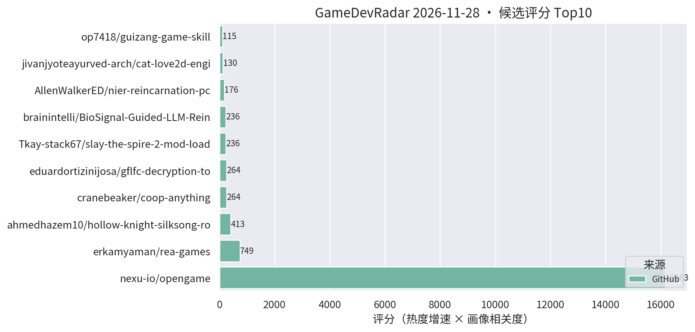
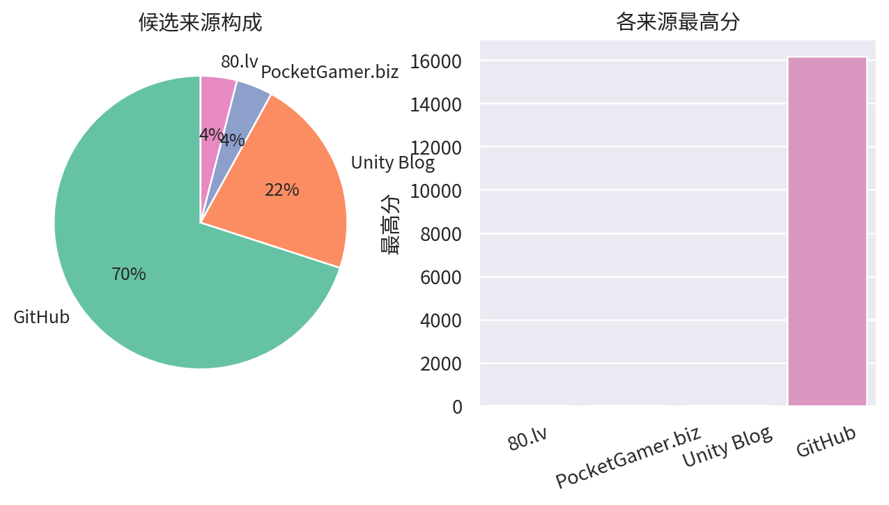

# 游戏开发技术雷达 · 2026-11-28（LLM 点评版）

> 采集于 2026-11-28 10:23 (UTC+8)。reddit/Unity 论坛照常 403，已跳过，不影响主榜；今日原始候选 323 条。

**今日看点**

1. **opengame 两日 2309★ 继续暴涨**——投放/刷量特征明显，但"AI agent 直发小游戏"赛道持续发酵，仍列观察不背书。
2. **SEO/灰色仓大回潮**：丝之歌存档、杀戮尖塔2 mod loader、GFLFC 解密换号、rea-games、nier/TotK/cat 家族齐上榜，今日剔除 8 条创近期新高。
3. **blender-skills 今日罕见落榜**（增速回落），godot-skills 53★ 回榜；guizang-game-skill 524★、oni-moono 292★、LGUI 176★ 稳态上行。

| 评分 | 项目 / 话题 | 来源 | 信号 | 简介 | 点评 |
|---|---|---|---|---|---|
| 16163.0 | [nexu-io/opengame](https://github.com/nexu-io/opengame) | github | 2309★ / 2天 | The Super Game Agent — the Unity & Unreal for AI agents, wit | 把 20+ coding agent 编成"AI 游戏工作室"，three.js 出 3D/小游戏直发微信/抖音/Telegram；方向正中 AI 工作流画像，但两日 2309★ 投放痕迹重，先看代码再下结论。 |
| 264.05 | [cranebeaker/coop-anything](https://github.com/cranebeaker/coop-anything) | github | 2218★ / 42天 | Co-op Anything: point your AI agent at any single-player gam | AI 逆向单机游戏加联机的 MCP，横盘第十二日；存量玩法改造思路启发极大，商用注意版权边界。 |
| 114.62 | [op7418/guizang-game-skill](https://github.com/op7418/guizang-game-skill) | github | 524★ / 16天 | 歸藏 Game Skill：让 AI 从零做出能在浏览器里玩的 3D 动作游戏，附可玩演示《雾锁山门》。Agent sk | 歸藏出品的 agent skill：three.js 单 HTML + AI 素材直出可玩 3D 动作游戏；"从零到可玩"的 skill 编排是 AI 工作流最强样板，必拆。 |
| 90.02 | [brenpoly/CardboardXR](https://github.com/brenpoly/CardboardXR) | github | 373★ / 29天 | Mobile VR with 6DoF head tracking, passthrough and hand trac | 用 ARCore/ARKit 给手机 VR 补 6DoF/透视/手势的 Unity 插件；做 XR 玩法验证不用再等 Quest，移动端原型利器。 |
| 65.75 | [rtmandreyev/construct](https://github.com/rtmandreyev/construct) | github | 179★ / 34天 | Persistent, editable objects for AI agents: researched part  | 给 AI agent 的持久可编辑对象系统：逐部件研究、来源溯源，可带入游戏/影视/CAD；agent 基础设施新思路，TA/程序化管线值得看。 |
| 54.67 | [LucasJRamos/spritekiln](https://github.com/LucasJRamos/spritekiln) | github | 184★ / 37天 | Animated pixel-art sprites (8-direction top-down or side vie | YAML 写程序化 3D 模型、烘出 8 方向像素精灵动画，专为 coding AI 设计且原生导出 Unity；做像素风卡牌/SLG 的强推。 |
| 42.95 | [Zengkailin/parametric-topdown-pixel-architecture](https://github.com/Zengkailin/parametric-topdown-pixel-architecture) | github | 250★ / 32天 | 参数化2D topdown像素建筑 - 把参数化 3D 建筑渲染成 2D 俯视像素图的本地网页工具（Godot hd2d | 参数化 3D 建筑一键烘成 2D 俯视像素素材的网页工具；引擎无关、本地即用，做 topdown 场景的 5 分钟稳赚。 |
| 38.62 | [Wendystar0628/AI-All-Round-Bench](https://github.com/Wendystar0628/AI-All-Round-Bench) | github | 175★ / 34天 | AI全能测评 \| AI All-Round Bench: timed challenge benchmarks for | AI coding agent 限时挑战基准（含游戏 AI、3D/web 应用等 10 类任务）；非游戏工具，但评估手头 agent 实战能力时值得对照，趋势级。 |
| 37.71 | [LumioGames/LGUI](https://github.com/LumioGames/LGUI) | github | 176★ / 42天 | Game UI framework for AI agents, made by LumioGames. Build s | 给 AI agent 用的游戏 UI 框架：浏览器搭界面/逻辑/测试再导出 Unity，FairyGUI/Puerts 技术栈；做 UI 自动化的抓紧试玩。 |
| 36.41 | [EL4CTEO/godot-skills](https://github.com/EL4CTEO/godot-skills) | github | 53★ / 8天 | Godot 4.7 Agent Skills for AI coding agents, based on Godot  | blender-skills 作者的 Godot 版：精确 API 查询 + 安全场景编辑 + 编译检查；引擎不对口但作者实力已验证，趋势级关注其 skill 工程方法。 |
| 33.95 | [tigin-backwards/oni-moono](https://github.com/tigin-backwards/oni-moono) | github | 292★ / 43天 | Oxygen Not Included's Unity layer on the BRUTAL framework, . | ONI 的 Unity 层迁到 BRUTAL + CoreCLR，后期殖民地约 8× 帧率；做性能优化/CoreCLR 迁移的活教材，强推一读。 |
| 29.92 | [christos-antono/NPCTalk](https://github.com/christos-antono/NPCTalk) | github | 234★ / 43天 | Make any NPC in any game talk back with Fish Audio: skills,  | 用 Fish Audio 让任意游戏 NPC 开口说话的 skill；mod 向非 Unity 工程向，语音 NPC 链路可参考，别指望直接进项目。 |

---
*由 GameDevRadar 生成 · 画像配置见 profile.json · 觉得哪类多了/少了就改画像, 别忍着*
